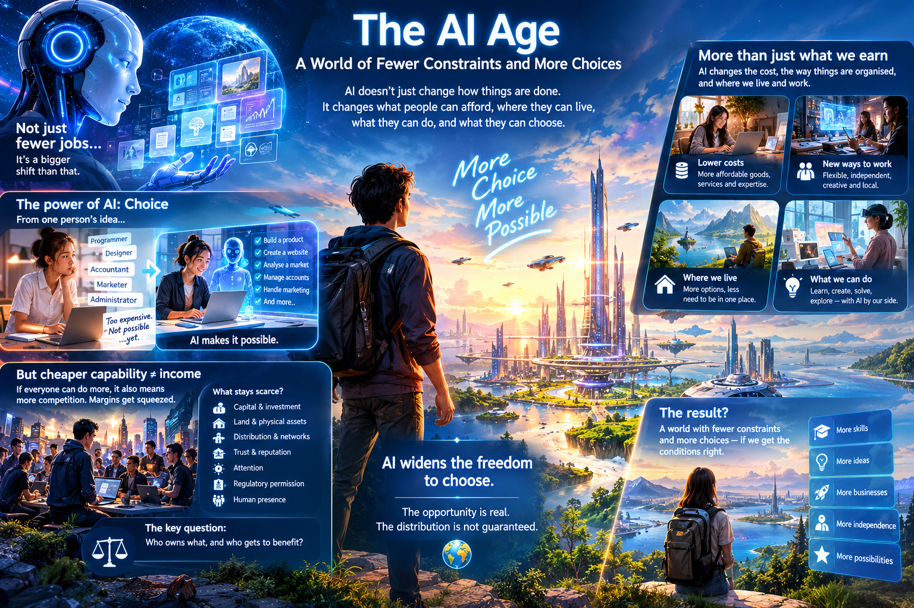

# The AI Age: A World of Fewer Constraints and More Choices

## Why we may be looking at the wrong side of the AI revolution

The popular debate about artificial intelligence has become strangely narrow. We ask how many jobs AI will destroy, how many people will be displaced, how much income workers will lose, and how much wealth will accumulate in the hands of those who own the technology.

These are legitimate questions, and the best economists who ask them go well beyond headline job counts. They ask about prices, new tasks and distribution. But most public discussion, and much of the anxiety that follows from it, starts from a simpler picture: tomorrow's world will operate much like today's, except that machines will do a growing share of the work.

That picture leaves out a great deal. AI will not only change how existing goods and services are produced. It will change what they cost, how businesses are organised, where people can live, what they can do for themselves, and how far they must depend on employers and large institutions. It changes not only what people earn, but what they can choose.

**The claim of this essay is conditional. AI enlarges the set of things people can do, and the set of things they can afford. Whether that enlarged set reaches most people, or only a few, is a political question about ownership, competition and access. The opportunity is real. Its distribution is not guaranteed.**

*\[Verify before publication: the serious academic work referred to above includes Daron Acemoglu and Simon Johnson, Power and Progress (2023); Erik Brynjolfsson, "The Turing Trap" (2022); and Daniel Susskind, A World Without Work (2020). Check titles, dates and that each is characterised fairly.\]*

## 1. We are measuring tomorrow with today's yardsticks

Much of the anxiety about AI rests on a straightforward calculation. If a company can use AI to do work previously done by ten people, it needs fewer employees. If millions of companies do the same, millions of jobs could disappear. If workers lose their incomes while the owners of AI capture the savings, inequality could worsen dramatically.

The arithmetic is reasonable. The conclusion depends on what happens next. It assumes that displaced workers must find comparable jobs in an economy whose structure is unchanged, that goods and services will cost what they cost today, that earning a living will remain tied to selling labour to an employer, and that AI's capabilities will stay concentrated in a few large corporations.

These are not laws of nature. They are features of the arrangements we have inherited, and a technology capable of transforming production can transform them too.

The strongest version of the pessimistic case deserves a direct answer. It does not say that demand will vanish. It says that new demand will be met largely by machines rather than by displaced people, so that labour loses its bargaining power even in a very rich economy. If that happens, cheaper goods are cold comfort to people with little income to spend. This essay takes that argument seriously. It does not dispute the danger. It disputes that the danger is the whole picture, and it asks what has to be true for the better outcome to arrive.

## 2. The most important thing AI creates is choice

Imagine a person who wants to start a business but cannot afford a programmer, designer, accountant, marketer and administrator. Today the idea stays an idea. The cost of assembling those skills is too high.

With capable AI, the same person may be able to build a product and a website, analyse a market, keep the accounts and handle much of the routine work of running a firm. AI does not guarantee success. It can make an attempt possible where there was no realistic opportunity before.

Multiply that across millions of people. Some will start businesses. Others will work independently, pursue creative projects, offer specialist services, or build products for small markets that large companies have ignored. Many will fail. But the cost of trying falls, and the number of people able to try rises.

The same applies beyond business. AI gives ordinary people access to expertise that was once expensive or hard to obtain: learning new skills, solving technical problems, navigating unfamiliar systems, doing tasks that previously needed a professional.

This does not mean everyone becomes an entrepreneur or enjoys a higher income. It means more people gain the practical ability to do things that were beyond their reach. A technology that expands what people can do expands what they can choose to do.

## 3. Cheap capability is not the same as income

There is an obvious objection, and it is the most important one to the argument so far. If AI makes capability cheap for everyone, then the solo entrepreneur in the previous section competes with every other AI-equipped entrepreneur, and with AI-native firms of any size. Lowering the barrier to entry does not create income. It compresses margins.

For choice to be real and not merely formal, something must stay scarce and be within reach of ordinary people. The candidates are capital, land and physical assets, distribution, trust and reputation, attention, regulatory permission, and human presence. Which of these carries the returns will decide who benefits. Where the scarce thing is owned by a few, the new freedom to try is a freedom to compete for the leftovers.

This is why the argument is about capability and not just opportunity. The economist Amartya Sen distinguished between a freedom that exists on paper and one a person has the means to use. AI widens the first by a large margin. Whether it widens the second depends on the conditions in the next section. *\[Verify: Sen's capability approach, e.g. Development as Freedom (1999); confirm the framing before citing.\]*

## 4. The real danger is not AI capability, but concentrated control

The benefits of AI will not be widely shared simply because the technology is powerful. If access to capable AI stays expensive, if a handful of companies control essential infrastructure, or if proprietary systems let owners levy a toll on every user, the gains will flow to a small group. In that case AI would make production far more efficient while leaving most people dependent on whoever controls the productive assets. Concentrated control does not merely threaten the hopeful scenario. It can cancel sections 2 and 5 outright.

The distinction that matters is between building the most advanced models and having access to useful capabilities. Frontier research may stay expensive and concentrated. But open-weight models, competition, smaller specialised systems and cheaper computing could put powerful tools in the hands of individuals and small enterprises. People do not need to own the largest training cluster to benefit, just as they do not need to own a power station to run a computer.

The power-station analogy also cuts the other way. We do depend on power utilities, and the real policy question was never whether to avoid dependence but how the dependence is governed. The same is true here. The mechanisms worth debating are concrete, and each has an objection:

- **Open-weight models and open tooling.** They keep a competitive floor under proprietary prices. The objection is that open release of the most capable systems may carry security risks, and that open models trail the frontier.
- **Affordable access to compute.** Public or subsidised compute could help small firms and researchers. The objection is cost, and the risk of subsidising incumbents.
- **Competition and interoperability rules.** Requirements to let users and data move between providers limit lock-in. The objection is that they are slow to enforce and can entrench the compliance capacity of large firms.
- **Broad ownership of the gains.** Citizen or sovereign equity stakes, or other dividends from AI-generated profits, would share returns directly. The objection is design: who holds the stake, how it is governed, and whether it crowds out other support.

The objective is not to stop companies building advanced AI. It is to prevent control of AI from becoming a permanent tollbooth through which everyone else must pass. The central question is not only who owns the most powerful system. It is who gets to use it, who captures the productivity gains, and how much independence it leaves everyone else.

## 5. Lower costs, and lower access costs, change what a lower income means

Economic pessimism often treats income as the measure of living standards. But income is only one side of the ledger. The other is what it costs to live.

A household's real position depends on the ratio of what it earns to what it must spend. The break-even rule is simple: if income halves, prices must also halve for the household to stay where it was. The relevant question is therefore which parts of the budget could plausibly fall that far.

The likeliest are the cognitive services: tutoring, legal and financial advice, software, design, research and administration. Much harder are the items that absorb most of a typical household's spending: housing, food, healthcare, childcare, energy and transport. Several of these are sectors where costs have historically risen faster than average, because they depend on land, physical infrastructure or human care that does not scale the way software does. This is the pattern economists call Baumol's cost disease. AI may break it in the cognitive parts of education and healthcare. It does little, on its own, for land or for the hands-on part of caring for people. Businesses with market power may also keep much of any saving rather than pass it on. *\[Verify: Baumol's cost disease and the sectors usually cited; consider adding a figure for the typical household budget split in your target country.\]*

So the honest claim is narrower than "prices will collapse." If AI makes a broad set of goods and services substantially cheaper, then a given income can stretch further, and the link between employment, income and material wellbeing weakens. The size of that effect depends on which budget lines actually move.

### The price of a postcode

There is a second kind of cost that does not show up in the price of goods: the cost of access.

For generations, where people live has been set by two forces: the need to earn a living and the need to educate their children. People move to cities because that is where the jobs are. Families compete for housing in particular neighbourhoods because those areas have the schools. A home near work or a sought-after school sells at a premium because buyers are not purchasing only a home. They are paying for access to opportunity. A family's prospects therefore depend not only on talent and effort but on whether it can afford the right postcode.

AI could loosen both ties. If more people can work remotely, run independent businesses and serve customers anywhere, earning a living no longer requires living beside a major employer. AI tutoring could bring personalised instruction to wherever a child lives. Families might then pay less of a premium for location and live in cheaper places without giving up as much of their prospects or their children's learning. AI and robotics could also lower construction costs and make adequate housing cheaper, although that depends on land, planning rules, infrastructure and whether the savings are passed on.

Three cautions apply. First, the workers best placed to work remotely for customers anywhere are those whose work is most exposed to AI. The capability that frees them from location also lets their employer or client do without them. Remote work only helps people whose services remain wanted, so the argument needs to say whose work that is. Second, much of the school premium pays for peer groups, credentials and signalling rather than instruction. AI can improve instruction without moving any of those, and early evidence on AI tutoring is mixed. Third, dependence does not simply disappear. Dependence on an employer may become dependence on an AI provider, a platform or the state. *\[Verify: current evidence on AI tutoring outcomes; cite specific studies if you keep this claim.\]*

None of this makes desirable land unlimited. People will keep valuing particular cities, climates and communities. Location will still matter, but for some essential opportunities it may matter less than it does today. A household's standard of living depends on income and on what it must pay to reach work, education and other essentials. We should ask about the economics of place as well as the economics of work.

## 6. Human wants do not disappear when machines become more capable

There is another reason to doubt that the loss of jobs leads inevitably to economic collapse. Demand is not a fixed quantity of work waiting to be automated. People have preferences, ambitions and needs, and they want products, services and experiences that do not yet exist.

As some goods and services get cheaper, people spend on other things: higher quality, more variety, better healthcare, personal attention, entertainment, travel, and services not yet widely available. New markets emerge, existing ones grow, and whole categories of activity become viable because they cost less to supply.

History gives reasons to take this seriously. Mechanisation transformed agriculture, industrial machinery transformed manufacturing and computers transformed office work. Each eliminated established tasks and also enabled new industries, products and forms of consumption.

But history does not prove that displaced workers will find good jobs, or that new demand will grow fast enough. The sharper worry returns here: new demand may be supplied by machines. What past transitions show is that the structure of economic activity is not fixed, not that people will inevitably be the ones to fill it. Whether they do depends on the ownership questions in section 4 and the distribution questions in the next section. The future cannot be understood by counting the tasks machines can perform today.

## 7. More productivity should mean more freedom, not merely more output

For generations, economic progress has been measured by more output, rising incomes and higher output per worker. These remain important. But AI poses a further question: what should society do when fewer human working hours are needed to produce what people want?

One possibility is that the gains accrue mainly to owners while everyone else faces greater insecurity, told that productivity is rising even as they struggle to hold on to a livelihood. Another is that greater productivity buys more material comfort with less compulsory work: shorter hours, more time with family, learning, caring for others, art, projects that never had the time before.

Neither is automatic. Keynes predicted in 1930 that within a century people in rich countries would work fifteen hours a week. Hours did fall sharply from the late nineteenth century into the mid-twentieth, largely through bargaining and legislation, and then largely stopped falling even as productivity kept rising. That record is the best evidence that productivity becomes freedom only when institutions make it so. *\[Verify: Keynes, "Economic Possibilities for our Grandchildren" (1930), and the trajectory of average annual hours worked; use a sourced series, for example from the OECD or Our World in Data, before stating any figures.\]*

Employment is a means of securing a livelihood. It is not the purpose of human life. The goal of economic progress is to expand people's ability to live lives they value, not to preserve every existing job or to maximise hours worked.

## 8. The transition will be difficult

None of this requires denying the disruption. Some occupations will disappear faster than new ones emerge. Workers will lose not only income but status, identity and a sense of purpose. Whole communities will be hit, and the gains will reach some sectors long before others. A society that distributes purchasing power mainly through employment will struggle if employment becomes less central to production.

The weakest point in the hopeful case is the gap in time and income between the jobs that go and the lower prices, new businesses and wider ownership that are supposed to follow. It is a real gap, and it will fall on real people. Closing it is a matter of policy: income support, retraining that works, and the ownership and access mechanisms in section 4.

## Conclusion: Judge AI by the choices it creates

The pessimistic narrative asks us to imagine machines taking jobs, reducing incomes and concentrating wealth in a technological elite. That future is possible and should not be ignored.

But AI also makes a different future possible: one in which people start businesses with fewer resources, buy expertise at lower cost, spend less to reach work and schooling, depend less on employers and gatekeepers, and spend more of their time on what they value. Whether that future arrives is a question of ownership, competition, access and social choice, and those questions are urgent precisely because the upside is so large.

So we should judge the AI age by a broader set of questions than the count of lost jobs. What can people do that they could not do before? What has become affordable that was out of reach? Where can they live, and how can their children learn? How much less dependent are they on any single employer, institution or provider?

**The most important measure of the AI revolution may be neither the number of jobs it destroys nor the wealth it generates, but the range of meaningful choices it places within reach of the many, and not only the few.**
