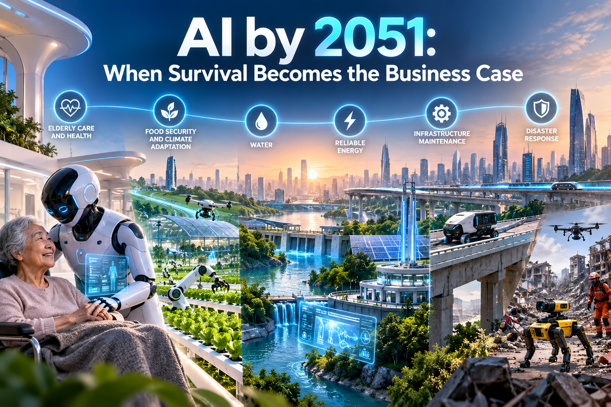

# AI by 2051: The Problems We Cannot Solve Any Other Way

*An argument, not a survey*

## The squeeze

By 2051 much of the world will ask for far more than it has the hands to give, and AI is the only lever large enough to close the gap.

Four pressures are converging. The share of people over 65 is heading from about one in ten today to about one in six by mid-century (United Nations projections, approximate), and Japan is already near three in ten. Climate volatility is making harvests, rivers and grids less predictable. The roads, pipes, bridges and grids built last century are wearing out. And whole classes of disease, from resistant infections to dementia, have no good answer at all. Meanwhile, in the countries ageing fastest, the workforce of 2051 has already been born, and it is not big enough.

Ageing is global but not uniform. East Asia, Europe and increasingly Latin America are already deep into it, while sub-Saharan Africa and much of South Asia still have young, growing populations. The United Nations projects the global share of people over 65 will double, from about 10% in 2024 to about 21% by 2074. The unevenness sharpens the argument rather than weakening it. The countries that adopt AI early keep their services running with shrinking workforces, and the young countries can leapfrog straight to machine-assisted systems instead of building human-intensive ones first.

Every conventional lever has a ceiling. Retirement ages cannot rise forever, least of all for physical jobs. Immigration is contested, and many of the source countries are ageing too. Higher pay only moves the bill. Prevention reduces need but does not abolish it. Budgets are stretched. What remains is to make each worker do the work of many, and to do what no number of workers could. That means AI and machinery.

This essay argues that this is not a hope but a calculation. For each core problem it asks the same three questions: why is there no other answer, what has AI already done, and does the arithmetic allow the rest?

## Problem 1: Too many old, too few hands

Care is the sharpest squeeze, and the arithmetic says AI closes it with room to spare.

Care cannot be made cheap by ordinary economics. An hour at the bedside takes an hour. Under Baumol's cost disease, sectors built on human time must keep raising wages to compete for workers while their productivity barely moves, so their relative cost climbs just as the number of people needing them explodes.

Here is the target. In a fast-ageing country, suppose the number of older people per worker doubles by 2051 (a stress case; the real rise for the fastest-ageing countries is plausibly 1.5 to 2 times, approximate). Care would have to grow from about 5% of the workforce to 10%. To hold it at 5%, each carer needs **twice the leverage** they have today. Four tests show that is within reach.

**Test 1: how much work must machines take over?** If machines absorb a share *a* of the hours, a carer's leverage becomes 1 / (1 - a). Doubling it needs only a = 50%. Taking 70% of hours gives 3.3x, and 80% gives 5x. Much of a carer's day is documentation, lifting, moving, fetching and watching, not irreducibly human contact.

**Test 2: the demand side.** Total care demand is the number of older people times the care each needs. If better medicine cuts the years spent needing heavy care from ten to five, the care each person needs halves. That alone cancels the doubling of the ratio, before a single machine is installed.

**Test 3: do machines pay?** Take a care robot costing \$60,000, lasting seven years, with 10% a year for maintenance, \$5,000 for software and supervision, and 500 W of electricity at \$0.12 a kWh. It costs about \$20,000 a year. A carer on \$55,000 working 1,700 hours costs about \$32 an hour. The robot breaks even at roughly 620 hours of useful work a year, under two hours a day. At the same 1,700 hours as a human it costs about \$12 an hour; at 6,000 hours, about \$3.

**Test 4: can enough be built?** From 100,000 units a year in 2030, growth of 20% a year yields about 4.6 million a year by 2051, and 30% yields about 25 million. Scale is not the obstacle.

| Check | Needed | Available (illustrative) | Verdict |
| --- | --- | --- | --- |
| Care leverage per worker | 2x | 2x at 50% of hours automated; 3.3x at 70% | Passes |
| Care demand per older person | No requirement if leverage is met | Halves if dependent years fall from 10 to 5 | Passes, doubles the margin |
| Unit economics | Machine cheaper than carer | Break-even at about 620 hours a year against 1,700 | Passes |
| Manufacturing scale | Millions of units a year | 4.6 to 25 million a year by 2051 | Passes |
| Combined margin | 2x | Up to 4x | Passes with 2x to spare |

The mathematics says no in only one place. If more than half of care is irreducibly human, automating everything else caps leverage below 2x, and healthspan must carry the rest. That is the assumption that bears the weight, and nobody has shown that it holds.

Early evidence points the right way. A UK care home that installed AI-enabled lamps and sensors recorded [84% fewer falls](https://leadingage.org/wp-content/uploads/2023/03/Case-Study_Hartford-House-AI-Preventing-Falls.pdf) in a vendor-published pilot. That is one home and one vendor, but it is the direction of travel.

Now the bold part. By 2051 the heavy and indignifying parts of care, lifting, turning, bathing and fetching, may be done by capable machines working in ordinary homes. A lone night nurse could supervise what once took a team of ten, and older people could stay independent in their own houses for years longer. The scarce human hours go to company, judgment and touch.

## Problem 2: Food, water and power in a volatile climate

A hotter, more erratic climate raises the cost of keeping people fed, watered and powered, while the farm and utility workforce shrinks, and AI is already cutting the waste.

Three real results show the mechanism. John Deere's See & Spray, which fires nozzles only at weeds, covered over 5 million U.S. acres in 2025 and [cut non-residual herbicide use by nearly 50% on average](https://www.deere.com/en/news/all-news/see-spray-technology-across-5-million-acres/), saving about 31 million gallons of mix (Deere's own figures). A Swedish water utility, VA SYD, used AI leak detection on its existing meters and [cut network water losses from 10% to under 8%](https://www.siemens.com/en-gb/company/insights/va-syd-water-artificial-intelligence/), finding leaks as small as 0.5 litres a second (a vendor case study). In each case a small amount of machinery let a limited number of people cover far more ground.

The extension is not subtle. Fleets of autonomous machines could plant, tend and harvest around the clock, treating each plant as an individual. Crops could be bred in months for a specific valley's future climate. Cities could find and fix every leak while it is still a drip. And the deepest answer to climate stress, cheap, clean, abundant power, is a materials and control problem of exactly the kind AI is beginning to crack: new battery and catalyst chemistries, plasma control for fusion, smarter grids. Abundant energy turns desalination, recycling and electrification from luxuries into defaults.

## Problem 3: A physical world wearing out

Bridges, roads, pipes, grids and homes need constant upkeep and a shrinking, ageing trade workforce to supply it, and AI turns upkeep from an emergency into a routine.

Neglect compounds: a hairline crack becomes a failure, a failure becomes a disaster. Sensors, drones and AI inspection find defects early and shift maintenance from fixed schedules and emergency repair to repair by condition, spending thin budgets where the risk is highest. Push the line forward and you get small autonomous repairers working inside water mains and along rail lines, structures that report their own fatigue, and robotic assembly that builds homes, clinics and care facilities faster than any human crew can, just when ageing societies need them most.

Disaster warning is where AI has already crossed a line. Google DeepMind's GraphCast beat the world's leading physics-based forecast system on [90% of 1,380 measures](https://oodaloop.com/briefs/technology/ai-outperforms-conventional-weather-forecasting-methods-for-first-time) and runs a ten-day forecast in under a minute on a single chip. It called Hurricane Beryl's turn toward Texas [nearly a week earlier](https://www.insurancejournal.com/news/national/2024/11/19/801655.htm) than conventional forecasts did. Floods, fires and heatwaves will hit an older, more fragile population harder, so every extra day of warning is worth lives and money.

## Problem 4: Diseases we have no answer for

Some problems are intractable not for lack of money but because the space to be searched is too large for human laboratories, and AI is the first tool that can search it.

The space of drug-like molecules is estimated at around 10 to the power of 60 (approximate). A lab can synthesise thousands. Three results show what changes when a machine does the searching:

- **Protein structure.** Experiments had solved [about 190,000 structures in sixty years](https://www.technologynetworks.com/proteomics/news/alphafold-wins-the-nobel-prize-in-chemistry-2024-391930), often at a year or more each. AlphaFold now offers 200 million predictions, won a share of the 2024 Nobel Prize in Chemistry, and has been used by [over three million researchers in more than 190 countries](https://network.febs.org/posts/alphafold-five-years-on-what-this-new-era-means-for-molecular-life-sciences). A fifty-year-old problem became a lookup.
- **Antibiotic resistance.** Drug-resistant infections cause nearly 5 million deaths a year, and for decades most new antibiotics have been variants of old ones. In 2025 MIT researchers used generative AI to [design more than 36 million compounds](https://news.mit.edu/index.php/2025/using-generative-ai-researchers-design-compounds-kill-drug-resistant-bacteria-0814) that existed in no library, and found candidates that cleared drug-resistant gonorrhoea and MRSA in mice through a new mechanism. This is preclinical, but it is the first crack in a wall that stood for generations.
- **Drug pipelines.** A 2024 analysis found that AI-discovered molecules [passed Phase I trials 80 to 90% of the time](https://www.htworld.co.uk/news/ai/ai-discovered-drugs-achieved-higher-success-rate-than-those-by-humans-study/), against 40 to 65% historically. The honest caveat is that Phase II success, about 40% on [a small sample](https://healthmanagement.org/c/it/News/clinical-potential-of-ai-in-drug-discovery-and-development), is so far no better than the norm. AI can design drugs that are safe; it has not yet shown it can predict which will work. That is a prediction problem, exactly what the curve in the next section is built to erode.

| Stage | Historical success | AI-discovered (reported) | Scenario for 2051 |
| --- | --- | --- | --- |
| Phase I | 40-65% | 80-90% | 85% |
| Phase II | 30-40% | About 40%, small sample | 80% |
| Phase III | About 55-60% (approximate) | Too little data | 80% |
| End to end | 5-10% | 9-18% (projected) | About 49% |

The last column is a scenario: Phase I at 85%, Phases II and III at 80%, approval at 90% (an assumption). Multiply them and about half of all candidates succeed, five to ten times today's rate, with the cost of each approved drug falling accordingly.

This is healthcare, the hardest test of all: regulated, safety-critical and built on trust. If AI works here it works anywhere, and it feeds straight back into Problem 1. Record life expectancy has risen by roughly two and a half years per decade for over a century and a half (approximate), almost entirely without AI. If AI-driven medicine converts even a fraction into years free of dependence, say a two-year delay per decade, that is five years by 2051, the very shift that halved care demand above. The same technology that supplies capacity also shrinks the need for it. Dementia, cancer and the diseases of old age are the next targets, and each is a search-and-prediction problem of the kind that has just begun to yield.

## Problem 5: Security with too few young people

Defense runs on the young, the young are becoming scarce, and the answer is already visible on the battlefield.

South Korea, which relies on conscription, is planning for a shrinking conscript pool. Japan's forces have repeatedly missed recruitment targets, and several Western militaries have struggled to fill their ranks (approximate; check current figures). A country cannot decree a larger cohort into existence, and deterrence needs mass.

In Ukraine, small drones now account for [around 80% of battlefield casualties](https://kyivindependent.com/analysis-how-ukraine-gained-the-upper-hand-in-the-drone-war/), and the Russian-to-Ukrainian casualty ratio has [climbed from 2:1 or 3:1 to nearly 8:1](https://www.novinite.com/articles/239395/Russian+Military+Casualties+Reach+8-to-1+Ratio+Against+Ukraine+as+Drone+Warfare+Intensifies) in early 2026, according to a CSIS analysis. These figures are mostly Ukrainian-sourced and hard to audit, but the pattern is clear: a small number of people with cheap autonomous systems can hold ground that once needed an army. A country of eight million people may secure itself with sensors, drones and interceptors under human command. The one line that must not move is the decision to use lethal force, which stays with accountable humans.

## Why this curve will not stop

The case so far uses cautious numbers. The real rate of progress is steeper.

In 1990 the internet was a research network with a few million users at most (approximate). By 2010 around two billion people were online, close to a third of humanity (approximate), roughly 600-fold growth in twenty years, about 38% a year compounded. In 1995 a spreadsheet could have proved that online shopping, search and social media were tiny markets. Every such projection was right about the present and wrong about the curve.

The AI curve is steeper and it is accelerating. METR measures the length of task, in human-expert hours, that frontier AI can complete at 50% reliability. Its original estimate was a doubling about every seven months for 2019 to 2024. Its January 2026 update puts the post-2023 [doubling time at about 131 days](https://en.wikipedia.org/wiki/METR), around 4.3 months. Claude Opus 4.6 measured at [about 14.5 hours](https://officechai.com/ai/exponential-progress-claude-opus-4-6-has-50-time-horizon-of-14-5-hours-on-metr-time-horizons-benchmark). The measure covers mainly software tasks at 50% reliability, so it is a yardstick, not a law. But extrapolate it to 2051, 300 months away, using horizon = 14.5 hours x 2^(300 / D), where D is the doubling time in months, and let progress slow dramatically:

| If the doubling time slows from 4 months to | Task horizon by 2051 | In human terms |
| --- | --- | --- |
| 17 years | About 40 hours | One work-week: the sceptic's floor |
| 3.5 years | About 2,000 hours | One work-year |
| 2 years | About 84,000 hours | Roughly 40 work-years, a full career |
| 1 year | Hundreds of thousands of work-years | Beyond any task a person could finish |

For AI to be limited to a single work-week of autonomous effort in 2051, progress would have to slow to about fifty times below today's pace and stay there for a quarter-century. Nobody who has watched the last five years believes that. Dramatic change is the default. The only live question is who captures it and how fast we get there.

## The one thing that can still go wrong

The danger is not that AI fails to arrive. It is that it arrives late, unevenly or on someone else's terms.

Necessity does not guarantee delivery. The buyer pays but someone else banks the saving. Governments cannot fund the upfront cost. Liability rules freeze deployment. And the largest question is ownership: whoever owns the machines that keep hospitals, grids and farms running holds enormous power. If a few firms or foreign states control them, dependence on AI becomes the new dependence on oil, fought over just as hard. A country can hold the technology in principle and still fail to deploy it affordably, and the gap between the countries that can and cannot will be the great divide of the century.

## What to do about it

1. **Stop treating AI in essential services as a pilot.** Pilots are how societies avoid deciding. Fund deployment with outcome-based contracts and long-term purchasing commitments.
2. **Pool the budgets.** When the provider pays and the health system saves, nobody buys. Join the accounts so whoever bears the cost can capture the gain.
3. **Treat compute and energy as national infrastructure.** The technology that saves water and power also consumes both, and the sums must come out in society's favour.
4. **Decide who owns the machines before they are indispensable.** Afterwards there is no leverage.
5. **Make the safety bar real.** Machines in care homes, on roads and in uniform must earn trust through audited records, human oversight and the consent of those they serve.

## The verdict

A world with far more old people, far fewer workers, a harsher climate, a crumbling physical plant and diseases we cannot cure cannot be run on today's methods. Something must supply the missing capacity, and machines are the only candidate that scales. They are also the only candidate that can attack problems no workforce, however large, could ever solve.

The arithmetic allows it. The evidence is arriving. The curve is steep. What remains is a choice: use AI early, deliberately and fairly, or late, in a crisis and on someone else's terms. The bill is coming either way. The only choice is whether to pay it in advance, and how much of the cure to claim.

---

*Note: figures marked approximate come from general knowledge and should be checked against current UN, OECD, IPCC, FAO, IEA and ITU data before publication. Dollar figures, share assumptions and the 2051 drug scenario are illustrative. Results from companies and vendors are self-reported.*
