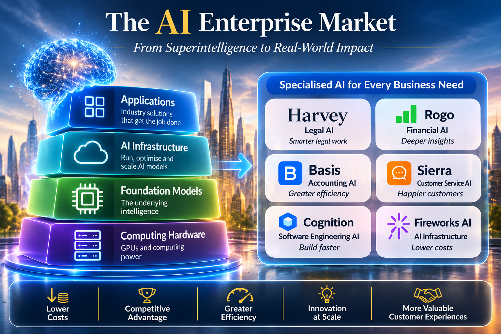

*How the AI industry fits together, where business value is created and why the smartest model does not automatically produce the strongest business.*

Most people meet artificial intelligence (AI) through a chatbot. But the larger story is happening inside businesses. Law firms, banks, accounting teams, call centres and software companies are starting to use AI not just to answer questions, but to do real work: reviewing contracts, preparing financial research, resolving customer complaints and writing software.

For readers of this book, this is the commercial counterpart to the engineering story. Cheaper code and more capable models matter because they change what organisations can build, buy and delegate. Understanding the companies supplying that capability helps explain where the opportunities lie, and where the constraints remain.

One idea runs through everything that follows: **the company with the smartest AI is not automatically the company that makes the most money.** Value tends to flow to whoever makes AI useful, affordable and trusted inside real businesses.

*The companies named here are illustrative, not a ranking. Products and ownership change quickly; the aim is to explain the structure of the market rather than catalogue every supplier.*

## 1. The Layers of the AI Industry

A useful way to understand the industry is to separate it into five layers. The infographic groups chips and cloud computing under computing hardware; the table separates them because designing processors and operating data centres are different businesses.

The boundaries are porous. A cloud provider may design chips and develop models, while a model maker may also sell applications. The layers describe economic roles rather than mutually exclusive categories of company.

| Layer | What it is, in plain terms | Example companies |
| --- | --- | --- |
| 1. Chips and manufacturing | The physical processors that do the calculations | NVIDIA, AMD, Broadcom, TSMC, ASML |
| 2. Cloud and data centres | Giant buildings of computers that businesses rent | Amazon (AWS), Microsoft (Azure), Google Cloud, Oracle, CoreWeave |
| 3. Foundation models | The "brains": general-purpose AI systems | OpenAI, Anthropic, Google DeepMind, Meta, xAI, Mistral, DeepSeek, Alibaba (Qwen) |
| 4. Tools and infrastructure | The plumbing that makes models cheap, fast and safe to use | Fireworks AI, Together AI, Baseten, Databricks, Snowflake, Scale AI, Hugging Face |
| 5. Applications | Finished products aimed at a specific job or industry | Harvey, Rogo, Sierra, Cursor, Cognition, Abridge, Glean and many more |

A useful comparison is the electricity industry. Chips and data centres are the power stations and cables. Foundation models are the electricity itself. Infrastructure companies are the engineers who make the supply reliable and affordable. Applications are the appliances people actually use.

### Layer 1: Chips and Manufacturing

AI needs enormous computing power, both to build a model and to run it for millions of users. The specialised processors that do this work are called **GPUs** (graphics processing units, originally designed for video games) and similar "accelerators."

- **NVIDIA** is a major supplier of AI accelerators. Its position rests on both its hardware and an established software ecosystem.
- **AMD** also supplies GPUs for AI workloads.
- **Google (TPUs), Amazon (Trainium) and Microsoft** design their own custom chips, partly to reduce their dependence on NVIDIA. **Broadcom** helps build several of these custom chips.
- **TSMC**, based in Taiwan, is a crucial manufacturer of advanced chips. **ASML**, based in the Netherlands, supplies the extreme ultraviolet lithography equipment used in advanced chip manufacturing. These dependencies concentrate considerable power and risk in a small number of suppliers.

### Layer 2: Cloud and Data Centres

Most businesses do not buy their own AI hardware. They rent it. The big cloud providers (**Amazon Web Services, Microsoft Azure, Google Cloud, Oracle**) do this at huge scale, and specialists such as **CoreWeave** concentrate on accelerated computing workloads. This layer is extremely capital-intensive: hardware, buildings, cooling, network connections and electricity must be financed before customers can use the capacity. Access to power can constrain expansion as much as access to chips.

### Layer 3: Foundation Models

A **foundation model** is a large AI system trained on vast amounts of text, code, images and other data. Depending on its training and design, it can support writing, summarisation, translation, document analysis, software development and other tasks. It is general-purpose, like an engine that can be fitted into a car, a boat or a generator.

Examples include:

- **OpenAI** (ChatGPT) and **Anthropic** (Claude) develop general-purpose models as well as products for business users and software developers.
- **Google DeepMind** builds the Gemini models and can combine them with Google's cloud, chips and products.
- **Meta** has released Llama models as **open-weight**: their learned parameters can be downloaded and adapted, subject to the applicable licence. Open-weight does not necessarily mean unrestricted use or access to the original training data.
- **xAI** (Grok) and **Mistral** (France) are other significant Western developers; **Cohere** focuses on enterprise customers.
- **Chinese developers**, including **DeepSeek, Alibaba (Qwen)** and **Moonshot**, have produced capable models, including open-weight releases and competitively priced services. They matter both commercially and geopolitically.

A powerful engine does not make a successful business. A model alone does not understand a law firm's habits, a bank's regulations or a hospital's paperwork. That gap is where the rest of the industry lives.

### Layer 4: Tools and Infrastructure

This is the plumbing between a raw model and a working product.

**Training vs. inference.** *Training* is how a model learns, which may involve an initial pretraining run followed by further training and periodic updates. Large training runs can be expensive. *Inference* is what happens each time someone actually uses the model, such as asking a question or requesting a summary. Training is like building a factory; inference is like the running costs of operating it every day. For companies selling AI products, inference is a cost that never goes away.

Companies in this layer include:

- **Fireworks AI, Together AI and Baseten**, which provide services for deploying and running models. Depending on the platform, they also support fine-tuning and performance optimisation.
- **Databricks and Snowflake**, which provide data platforms and governance capabilities that help companies make their information available to AI applications under controlled access.
- **Scale AI** and similar firms, which supply the high-quality human-checked data used to train and test models.
- **Hugging Face**, a hub where developers share open models.
- **Vector database and tooling providers** such as Pinecone, which help AI systems look up the right information quickly.

Not every job needs the most powerful (and most expensive) model. A simple request can go to a small, cheap model; a complex legal analysis can go to a top-tier one. Sending each task to the right model is one of the quiet ways AI businesses protect their profits.

### Layer 5: Applications

Applications turn model capability into a product that someone can use to complete a job. Their value depends on the surrounding system: access to relevant information, integration with existing tools, reliable checks and a usable interface. This is where the engineering concerns of this book become commercial requirements.

## 2. Vertical AI: Software Built for One Profession

Traditional business software such as email, spreadsheets and customer databases is **horizontal**: it serves similar needs across many industries. **Vertical AI** is designed around a particular profession or industry, incorporating its documents, rules and routines.

A general chatbot can draft a contract clause. A law firm also needs confidentiality controls, access to its own precedents, integration with document systems and records that can be audited. The specialised product must bring these requirements together.

Some applications specialise in an industry; others focus on a function used across many industries. The following examples span both groups, and the tasks listed describe each category rather than every named product.

| Industry or function | Example companies and products | What the AI helps with |
| --- | --- | --- |
| **Legal** | Harvey, Legora, Thomson Reuters (CoCounsel), EvenUp | Research, contract review, due diligence, drafting, injury-claim demand letters |
| **Finance** | Rogo, Hebbia, AlphaSense, Bloomberg | Analysing filings and market data, preparing research, supporting deal work |
| **Accounting and tax** | Basis, Intuit and Thomson Reuters tools | Month-end closing, reconciliations, tax preparation, audit support |
| **Healthcare** | Abridge, Ambience, OpenEvidence, Epic (AI features) | Writing clinical notes from doctor–patient conversations, medical literature search, billing and coding |
| **Customer service** | Sierra, Decagon, Intercom (Fin), Salesforce (Agentforce) | Handling customer questions and requests end to end |
| **Software development** | Cursor, Cognition (Devin), GitHub Copilot, Replit, Lovable, Anthropic's Claude Code | Writing, testing and fixing code |
| **Company knowledge and search** | Glean, Perplexity, Microsoft Copilot, Writer | Finding answers across a company's documents and tools |
| **Data and government** | Palantir | Combining data from many systems for decisions, in business and government |

The economic implication is straightforward: if AI cuts the time needed for document review or research, a professional team can handle more work. That can lift productivity and profits, but it also challenges businesses that charge by the hour. Law firms and consultancies will have to rethink how they price their services.

## 3. From Chatbots to AI Agents

A **chatbot** answers questions. An **AI agent** is meant to *get things done*. Given a goal, it can plan steps, use other software, look up information and take actions.

Customer service shows the difference clearly. A chatbot can explain your delivery policy. An agent connected to the relevant systems can check an order, identify a delay, arrange a replacement within the company's policies and update the records. Cases outside its authority can be escalated to a person.

Software development shows it too. Early tools suggested the next line of code. Newer agents, such as Cognition's Devin, Cursor's agent mode and Claude Code, can take a task, explore a large codebase, make changes, run tests and report back. This does not remove the need for human engineers. Someone still has to decide what to build, judge whether the result is safe and correct, and take responsibility. But the job is shifting from typing every line towards directing and checking AI work.

Two technical terms are worth knowing:

- **Tools and connectors:** agents need permission to use a company's systems. The open Model Context Protocol (MCP), introduced by Anthropic, standardises connections between AI applications and external tools or data. A connection still needs appropriate permissions; the protocol does not decide what an agent should be allowed to do.
- **Human in the loop:** many businesses deliberately keep a person approving important decisions, especially early on.

Agents can create more value when they complete useful work, but their authority also increases the consequences of mistakes. An error can become a transaction, a changed record or a software release. The relevant measure is therefore the cost and reliability of a completed task, including the checking and intervention it requires.

## 4. The Platform Companies and Their Advantage

Several established giants matter here because they already own the customer relationship.

- **Microsoft** sells Copilot inside Word, Excel, Outlook and Teams, and is a major partner of OpenAI.
- **Google** weaves Gemini through Workspace, Search and Cloud.
- **Amazon** offers many models through its Bedrock service and is a major investor in Anthropic.
- **Salesforce, ServiceNow, SAP, Workday and Oracle** are adding AI agents to the business software their customers already use.

They have a strong distribution advantage: existing contracts, familiar products and established access to customer workflows. That does not guarantee that every AI feature will be trusted or adopted. Start-ups must prove they do something the giants cannot or will not do as well.

## 5. Where Does Lasting Advantage Come From?

If application companies such as Harvey or Rogo build on models from OpenAI, Anthropic or Google, what stops the model makers from competing with them directly? This is one of the central questions in the industry, and nobody can answer it with certainty.

A product that is just a chat window on top of someone else's model is easy to copy. A more defensible business tends to have several of these strengths:

1. **Deep industry knowledge.** Knowing how an investment bank actually prepares a deal is different from knowing language.
2. **Proprietary or customer-specific data** that makes the product better over time.
3. **Workflow integration.** Once a tool is wired into a company's daily systems, replacing it is painful.
4. **Security and compliance.** In law, finance and healthcare, meeting audit and privacy requirements is a real barrier to entry.
5. **Trust and track record.** In professional services, reliability matters as much as raw intelligence.
6. **Distribution.** Already having thousands of customers is a head start.

The strongest companies aim to *own the workflow*, meaning they become the place where a job actually gets done. Even so, none of these advantages is guaranteed. Model makers keep moving into applications (for example, with coding tools and enterprise assistants), and new competitors appear constantly.

## 6. The Economics: Revenue Is Not Profit

Traditional software is cheap to serve. Once it is built, one more customer costs very little. AI is different: each request uses computing power, and harder tasks use more.

Consider a hypothetical example, unrelated to any named company. A customer pays US\$100. Computing consumes US\$45 and other direct delivery costs consume US\$15, leaving US\$40 of gross profit: a gross margin of 40%. Research, sales and administration still have to be paid from that amount. If usage rises under a fixed subscription, the computing bill may grow while revenue stays unchanged.

That is why investors ask about:

- **Gross margin:** how much is left after the direct costs of delivering the product.
- **Cost per successfully completed task:** computing, retries, external services and human review needed to deliver an acceptable result.
- **Customer retention:** whether customers keep paying after the pilot.
- **Dependence on one model supplier,** which can change prices or terms.

There are reasons for optimism. Smaller specialised models can handle some routine work, caching can avoid repeated computation, and improved serving infrastructure can lower delivery costs. Those savings must be measured against the quality required and any increase in task complexity. But the biggest model makers are themselves spending enormous sums, so even market leaders face a race to turn heavy investment into lasting profits.

## 7. A New Business Model: Selling Completed Work

For decades, enterprise software sold **seats**: a company paid per employee who used the tool. The people still did the work.

AI creates the possibility of selling **outcomes**: a system that reviews the contract, resolves the support ticket or reconciles the accounts. Prices may then be linked to:

- documents processed,
- customer enquiries resolved,
- tasks completed, or
- measurable results.

This could enlarge the addressable market because the product competes for part of a service or labour budget as well as a software budget. It does not follow that every dollar of labour spending becomes software revenue: many jobs combine tasks that are difficult to separate, automate or price. Vendors must therefore prove that their results are worth the price and that delivery costs leave a sustainable margin.

The line between software and services is blurring. An AI company that performs accounting work may compete not just with other software vendors, but with accounting firms.

## 8. How AI Companies Win Enterprise Customers

Large organisations buy cautiously. They worry about security, reliability, legal exposure and whether the product delivers measurable value. A successful sale usually follows a path:

1. **A small pilot** on a real problem, with clear success measures.
2. **Proof of value,** such as hours saved or tickets resolved.
3. **Security and compliance review.**
4. **Wider rollout** across teams.

Several principles help vendors do this well:

- **Be on the ground.** Work alongside customers in their real environment rather than relying only on remote demos.
- **Make it repeatable.** Turn each successful installation into a standard process so the business can scale.
- **Move quickly.** Get to a live system fast enough to show value before enthusiasm fades.
- **Keep technical depth.** Buyers ask hard questions about architecture, data protection and performance, and sales teams must answer them credibly.

Enterprise AI is as much a business of implementation and trust as of technology.

## 9. The Risks Behind the Opportunity

A balanced view needs the downsides as well as the opportunities.

**Accuracy.** AI can produce confident but wrong answers, known as *hallucinations*. In law, medicine or finance, a mistake can be costly. Good products cite sources, keep humans in charge of key decisions, and test their outputs.

**Security and privacy.** Companies worry about confidential data leaking, and about *prompt injection*, where malicious text hidden in a document tricks an AI agent into doing something it should not. Agents with access to company systems raise the stakes.

**Regulation.** Applicable obligations depend on jurisdiction, sector and the role the system performs. Privacy, consumer protection, professional duties and sector requirements can all affect deployment. Compliance capability may favour better-resourced vendors, while also creating opportunities for specialist providers.

**Copyright and data rights.** Training data, licensed content and generated outputs can raise different questions about ownership and permitted use. Enterprises need to understand their rights to supply data to a system and to use the material it returns.

**Jobs and skills.** Entry-level work in law, accounting, customer service and programming may change fastest. That raises real questions about how junior professionals learn their trade if AI does the routine tasks. The balance between redesigned jobs, displaced tasks and new employment remains uncertain, and will differ across professions.

**Concentration of power.** A small number of companies control chips, cloud and top models. Disruption at one point, such as a chip shortage or a supplier dispute, can ripple through the whole industry.

**Geopolitics.** Export controls on advanced chips, tensions over Taiwan and its central role in advanced chip manufacturing, and competition between US and Chinese AI developers all shape the market. Supplier eligibility and access to technology can change with government policy.

**Energy and environment.** Data centres use very large amounts of electricity and water. Power availability is becoming a limit on growth.

**Financial bubble risk.** Spending on AI infrastructure is vast, and some deals involve companies investing in their own customers. If revenue does not grow fast enough to justify the investment, there could be painful corrections, even if the technology itself proves valuable. History offers a precedent in the dot-com era: the internet changed the world, but many early companies failed along the way.

**Vendor lock-in and reliability.** Businesses that build everything around one model or supplier are exposed if prices rise or service changes. This is pushing many towards using several models.

## 10. Where the Opportunities Lie

For all those risks, the potential is large and wide-ranging.

- **For businesses:** faster document work, lower support costs, quicker software development, better use of company knowledge and the ability for smaller firms to do what once required large teams.
- **For professionals:** more time on judgement, client relationships and complex problems, and less on routine paperwork.
- **For investors and founders:** openings in specialised applications, in infrastructure that lowers costs, in security, testing and compliance tools, and in services that help conventional companies adopt AI.
- **For consumers and society:** potentially faster medical documentation, wider access to legal and financial help, and more responsive services.
- **For emerging markets:** capable low-cost and open models lower the barrier to building local products in local languages.

Some of the most promising openings are the least glamorous: tools that check whether AI output is correct, systems that keep AI agents within safe limits, and consultancies that help traditional companies redesign their processes.

## 11. The Forces Likely to Shape the Market

These are plausible directions rather than a timetable or a prediction that every company will succeed.

1. **More specialised products.** General models will keep improving, but businesses will still pay for tools tuned to their field.
2. **More capable agents** handling whole tasks, which will reshape customer service, back-office work and professional services.
3. **Multiple models per company,** choosing by task for quality, speed and cost.
4. **Greater focus on cost and efficiency,** as repeated model use makes delivery costs increasingly important.
5. **Consolidation.** Expect acquisitions and failures, as large platforms buy promising start-ups and weaker products fade.
6. **Blurring of software and services,** with AI vendors competing directly with service firms.
7. **Stronger rules and standards** around safety, data and accountability.

## 12. Questions for Evaluating an AI Company

Whether you are a customer, investor or job seeker, these questions cut through the hype:

- Does the product complete real work, or just generate text?
- Which layer of the industry is it in, and who are its real competitors?
- How dependent is it on a single model supplier?
- What are its gross margins, and how do they change as customers use it more?
- How deeply is it built into customers' daily workflows?
- Does it meet the security, privacy and audit needs of its industry?
- Do customers keep and expand their use after the pilot?
- How does it handle mistakes, and who is accountable when things go wrong?

## Conclusion: The Value of Becoming Part of Daily Work

The enterprise AI market is not simply a race to build the cleverest model. Chips and data centres make AI possible. Foundation models supply the intelligence. Infrastructure makes it affordable and dependable. Applications put it to work inside industries.

The companies that capture lasting value are likely to be those that become hard to replace: the ones woven into how a law firm, bank, hospital or call centre actually operates. That might be an application company such as Harvey, Rogo, Sierra or Cursor, an infrastructure company such as Fireworks AI, or a platform giant such as Microsoft or Google that already owns the relationship.

The central shift is this: AI is moving from a tool people use to a worker organisations rely on. That could create a larger market than conventional software alone, and it carries larger questions about accuracy, accountability, jobs, regulation and who captures the gains. Anyone entering this field, as customer, investor or employee, should keep both halves of that sentence in view.

The argument connects directly to [[side-story-addendum-ai-market-landscape-report|When Intelligence Becomes Cheap]]: falling intelligence costs do not tell us who retains pricing power. It also complements [[side-story-addendum-enterprise-ai-customisation|Enterprise AI Customisation]], which examines when proprietary capability earns back its cost, and [[side-story-addendum-coding-agent-revolution|The Coding Agent Revolution]], which explores how software engineering itself can become a source of lasting advantage.

**The commercial prize is reliable work completed at a sustainable cost, with enough trust and integration that customers choose to keep using the system.**

## Sources and Further Reading

The company examples describe product categories, not independently verified performance or financial returns. These primary sources provide starting points for checking the products and concepts discussed:

- [Harvey](https://www.harvey.ai/), legal and professional-services AI.
- [Rogo](https://rogo.com/), AI for financial institutions.
- [Basis](https://www.getbasis.ai/), AI agents for accounting.
- [Sierra](https://sierra.ai/), enterprise agents and outcome-based pricing.
- [Cognition](https://cognition.com/), Devin and software engineering agents.
- [Fireworks AI documentation](https://docs.fireworks.ai/getting-started/introduction), model inference, deployment and training.
- [Model Context Protocol documentation](https://modelcontextprotocol.io/docs/getting-started/intro), connections between AI applications and external systems.
