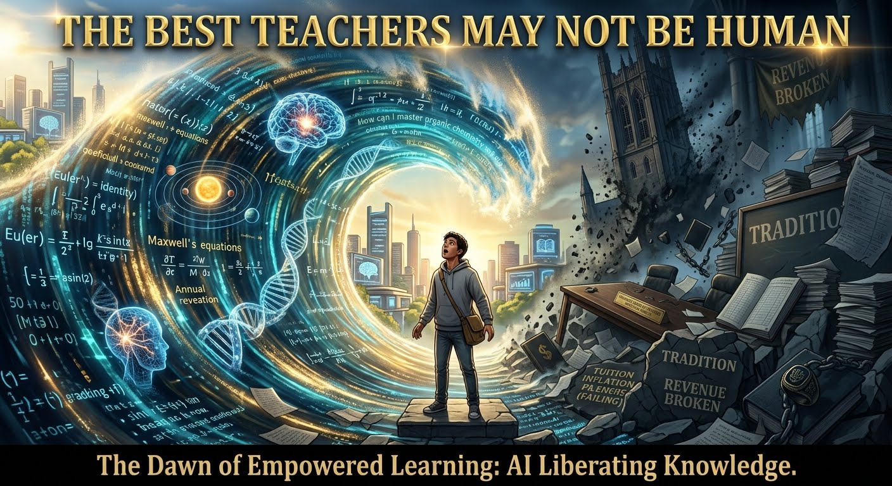

_An argument for rapid, rigorous and reversible experimentation in Singaporean education._

## We Have Been Rationing Good Teaching

We have been rationing good teaching and calling it schooling.

For centuries, education has rested on one assumption: only a human mind can guide another. We built the system around it. A classroom contains many children, one adult must track their misunderstandings, and a common syllabus sets the pace. The result is a lottery nobody likes to name: a child's progress depends partly on the teacher, school and peer group they happen to draw.

Two things can be true. A good teacher can produce great students. And, for many students, the best teacher they can realistically reach may soon not be human.

This is not a claim that an AI tutor is already better than the best human teacher. Exceptional teachers are rare and will remain rare. It is a claim about the instruction a child can actually receive. A well-designed AI tutor is already competitive with much of what is available, and its capabilities are improving quickly. Singapore should test that proposition now, rigorously and in public.

Parents already understand the scarcity. They compete for school places, reorganize family life around education and buy tuition when they can. Singapore resident households spent an estimated **S\$1.8 billion on private tuition in 2023**, according to reporting on the Department of Statistics' Household Expenditure Survey. [Families spent S\$1.8 billion on private tuition](https://www.straitstimes.com/singapore/spore-families-spent-1-8-billion-on-private-tuition-for-children-in-2023). Whatever their particular concern - teaching quality, peer environment, pace or examination pressure - their collective message is clear: the default is not enough for many families, and those with resources try to buy more individual attention.

Good teaching changes what a student becomes. That is why its uneven distribution matters. A child with an excellent teacher can move years ahead; another can stall through no fault of their own. We have never had a credible way to give every child the former.

The problem is not teachers' effort. It is arithmetic. No teacher can rebuild a difficult idea five different ways, in real time, for every learner in a large class. Some students are left behind while others wait, because shared pacing is necessary. For the student who needs a fourth explanation, that arithmetic can be cruel.

For more than a century, researchers have known that one-to-one tutoring can be extraordinarily effective. We have rationed it: affluent families buy it, while everyone else receives a portion of an adult's finite day.

An AI tutor has one student at a time. It does not tire, lose patience or run out of office hours. It can try a fourth explanation, answer the question that falls outside the lesson plan, and remain available when a question occurs at eleven at night. Properly designed, it can identify where understanding breaks and rebuild from there in the conversation, rather than waiting weeks for a marked examination.

The practical choice for many students is not between AI and an ideal teacher. It is between one-to-one attention and a small fraction of someone's day.

That ratio does not prove that AI teaches well. It establishes the opportunity. The scarcity that reserved excellent individual instruction for the few is no longer technically inevitable. The question is whether we can remove it without sacrificing independent thought.

## Three Ceilings

Consider a student spending a term learning Python. Outside the classroom, coding agents can already build substantial parts of the software she is learning to build. The skill still matters, but it is no longer the only route to the outcome. The fastest route does not necessarily run through the conventional classroom sequence.

That exposes three ceilings on what a Singapore student can reach:

1. **The curriculum ceiling.** Students advance through knowledge selected and sequenced years earlier.
2. **The assignment ceiling.** Instruction partly depends on the teacher and learning environment a student happens to receive.
3. **The access ceiling.** The tools students may use wait on institutional approval cycles that cannot match technological change.

Singapore built one of the world's strongest education systems. That is precisely why it should not let a successful system become the thing that limits its students.

The usual response is that AI must be tested, approved, piloted and reviewed. It should be. But the present arrangement should not be exempt from the same standard. A many-to-one classroom is not a research finding; it is a practical inheritance.

The case for standing still is also a claim. It implies that individual instruction should remain a privilege for families able to purchase it, and that a technology capable of changing the distribution of attention should wait until every uncertainty disappears. That is not caution alone. It is a decision about who receives the best available support while we wait.

## The Strongest Objection Is Real

The strongest argument for caution deserves respect.

In a preregistered field experiment involving nearly 1,000 high-school mathematics students in Turkey, students using an ordinary GPT-4-style assistant performed better during AI-assisted practice but **17% worse** than the control group on a subsequent unaided exam. The lesson was not merely that AI can make students faster. It was that it can let them produce answers without building understanding. [The peer-reviewed study](https://www.pnas.org/doi/10.1073/pnas.2422633122) is not a Singapore study, and it examined one mathematics setting, but it is an important warning.

It is also more informative than a simple verdict against AI. The same study tested a guardrailed tutor, built with teacher input and designed to provide hints rather than answers. That group did not suffer the same decline on the unaided exam; its performance was statistically indistinguishable from the control group. The experiment does not show that every AI tutor works. It shows that design matters, and that unguided access and good instruction are different interventions.

The positive evidence is promising but bounded. In a randomized controlled trial of 194 students in a Harvard introductory physics course, a purpose-built AI tutor produced larger learning gains, in less time, than the active-learning classroom comparison. [The published study](https://pmc.ncbi.nlm.nih.gov/articles/PMC12179260/) is notable, but it is one university course, two weeks of material and a carefully designed tutor. It is a reason to test, not a license to declare the question settled.

That is the central point. The evidence does not prove that AI-led education is the answer. It also does not justify treating the proposition as disproven. For a question this consequential, the right response is fast, transparent experimentation.

## This Is Not an Attack on Teachers

Singapore's teachers are not the problem. By international standards, they are well regarded and heavily committed. The OECD's TALIS 2024 results reported that 71% of Singapore teachers felt their profession was valued by society, compared with an OECD average of 22%. Teachers reported working about 47 hours a week, while Singapore's Ministry of Education has separately reported a 53-hour term-time figure. Marking and administration are among the pressures they identify. [MOE's TALIS 2024 release](https://www.moe.gov.sg/news/press-releases/20251007-singapore-teachers-embrace-digital-technologies-and-benefit-from-strong-professional-development-oecd-talis-2024-study).

That is an argument for using scarce human attention better. Every hour spent on routine marking, administration or endlessly repeated explanation is an hour unavailable for the student quietly falling behind, the student who needs challenge, or the child whose difficulty is not academic at all.

AI can take some of the repetitive work: first-pass feedback, practice generation, routine marking, translation between representations and patient repetition. Teachers can spend more of their time on what remains distinctly human: judgment, mentorship, safeguarding, motivation, social understanding and care.

Human teachers should not be protected by sentiment or displaced by fashion. Their roles should be justified by demonstrated value. Where human instruction works best, keep it and give the best teachers more time with students. Where an AI-led approach works better, use it. Where the combination wins, build the combination. The standard should be learning, not loyalty to a delivery mechanism.

## Access Must Be Separated From Credit

From secondary school onward, every student should have a publicly funded entitlement to capable general-purpose AI, including reasoning systems and coding agents. Not a toy sandbox that lags behind real capability, but a supervised and equitable route to the tools students will encounter outside school.

That does not mean that every use earns academic credit. The mathematics experiment makes the distinction plain: if marks reward correct answers and AI supplies correct answers, students have a rational incentive to outsource the thinking.

So separate access from assessment. Give students broad access to powerful tools, but award credit only for work they can genuinely demonstrate and defend. Assess three things:

- **Independent competence:** what a student can do without AI.
- **AI-augmented capability:** what they can investigate, design and build with it.
- **Intellectual growth:** whether AI-assisted work leaves them more capable over time.

Keep independent examinations. Add oral defences, live explanations, project histories and frequent low-stakes checks. A student who has delegated too much thinking should discover that early, when there is time to recover. In a system where high-stakes assessments shape behaviour, assessment is the real curriculum. Change what is measured, and behaviour follows.

Once access is separated from credit, learning can start from ambition rather than permission. A student interested in renewable energy need not wait years before encountering optimization, modelling or code. She can begin with the problem, acquire the foundations as the work demands them, and be assessed on whether she understands. Foundations remain essential. The curriculum should lay them. It should not cap ambition.

## A National Educational Frontier Programme

Singapore should launch a National AI Educational Frontier Programme in the next academic year. It should compare, with independent evaluation, three broad arrangements:

1. **Calibrated integration:** the current, cautious approach.
2. **Open access, human-led:** broad AI access with predominantly human instruction.
3. **AI-led:** AI-led instruction and inquiry, with human educators responsible for safeguarding, mentorship, assessment and accountability.

The programme should span secondary schools, junior colleges, ITE, polytechnics and universities, with more cautious, adult-mediated designs for primary learners. It should use real comparison groups and publish results whether they flatter the programme or not.

Stop rules should be declared in advance. If an approach harms independent learning, it is modified or paused. Measure independent competence, retention, transfer to unfamiliar problems, engagement, wellbeing, teacher workload, equity and cost. Ask one question above all: does AI help most the students who currently receive the weakest instruction, or mainly those who are already ahead?

If it is the first, Singapore may have found one of its strongest equity tools in a generation. If it is the second, the design must change, and a serious trial will reveal that quickly.

## The Cost of Delay

A student's declining independent mathematics performance is a visible failure. The failures of delay are less visible: the child never inspired to pursue advanced mathematics; the talent no syllabus tested; the investigation never attempted because the tool was unavailable. Nobody files a report on the scientist who was never made.

Where a change can be tested and reversed, move quickly. Where consequences are serious, demand more evidence. The alternative to recklessness is not paralysis. It is rapid, rigorous, reversible experimentation.

Education is not merely preparation for employment. It should produce citizens with independent judgment, professionals able to solve hard problems and researchers who extend human knowledge. The more capable AI becomes, the more human decisions matter: the goals, assumptions, evidence and responsibility behind the work.

Singapore has transformed itself through education before. Its strength has been its ability to adapt when circumstances change. They are changing now.

A good teacher can produce great students. For generations, that meant one exceptional teacher for a fortunate few. For the first time, it could mean excellent individual instruction for every child - and the teacher may not always be human.

No student's development should be capped by the curriculum's pace, the luck of the draw or an approval process slower than the technology. Keep the standards high. Take the ceilings down.

AI will not wait for the next curriculum review. Neither should Singapore.
