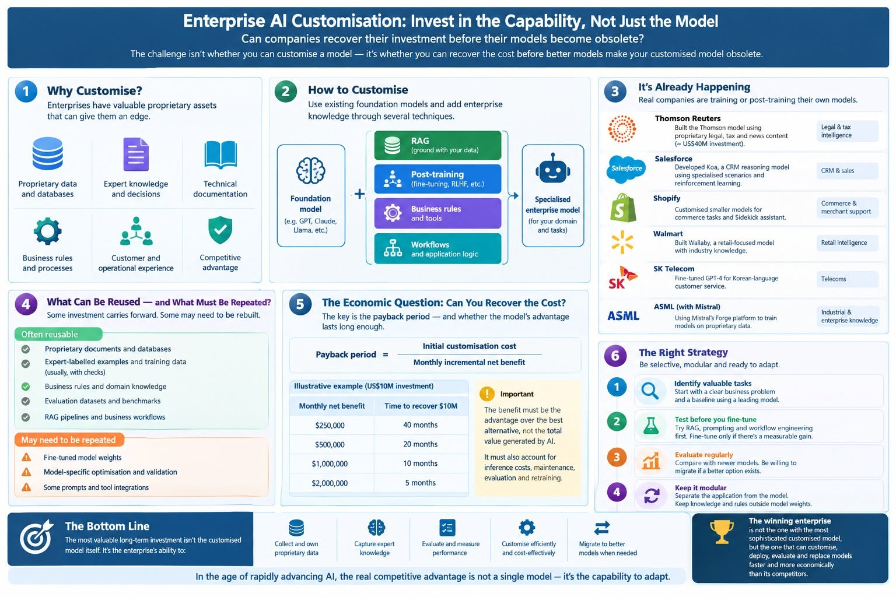

The rapid advancement of artificial intelligence has handed large enterprises a strategic dilemma. They can post-train existing foundation models into specialised systems of their own, or they can rely on the increasingly capable general-purpose models built by the leading AI laboratories. Customisation is technically feasible and already being pursued commercially. Its long-term economics are another matter.

The central issue is not whether a company can customise a model. It is whether the company can recover its investment before technological progress erodes the advantage that the model provides. A model can keep working perfectly well and still stop being worth what it cost.

## From AI Consumers to AI Developers

Large enterprises hold assets that general-purpose models do not: decades of operational experience, specialised databases, records of expert decisions, technical documentation and an intimate knowledge of how their business processes actually run. In principle, those assets let them build models that outperform general alternatives on particular tasks.

Building a foundation model from scratch is prohibitively expensive for almost every enterprise. The practical route is a ladder of increasingly invasive interventions:

- **Prompting and workflow engineering** change how an existing model is instructed and orchestrated, and leave the model untouched.
- **Retrieval-augmented generation (RAG)** lets a model consult proprietary documents and databases at the moment of use, again without changing its weights.
- **Post-training** starts from a pretrained model and reshapes it through supervised fine-tuning, expert feedback, preference optimisation or reinforcement learning.
- **Continued pretraining** pushes further, exposing an open-weight model to large volumes of domain text before post-training begins.

The rungs serve different purposes. RAG provides access to information; post-training changes how a model behaves and performs. Most serious deployments combine several rungs, alongside business rules, external tools and specialised workflows. The strategic objective is to turn institutional knowledge into proprietary AI capability rather than depend entirely on intelligence supplied by outside providers.

### Why companies customise

The motives are not all the same, and the difference matters for the economics later in this essay. Companies customise to:

1. **Raise accuracy** on narrow, high-stakes tasks where general models are close but not close enough.
2. **Improve consistency**, so that outputs follow house formats, policies and terminology reliably.
3. **Cut unit costs and latency** by running a smaller specialised model at high volume instead of paying frontier prices per token.
4. **Control data and deployment**, which for regulated and government customers can mean private clouds or air-gapped environments where external models cannot go.
5. **Reduce dependence** on a supplier's pricing, architecture and product roadmap, and, for companies that resell AI-enabled products, recapture margin otherwise paid to a model provider.

The first two are performance advantages, and general models can erode them. The last three are cost, control and strategic advantages, which tend to last longer. An honest investment case separates them.

## This Is Already Happening

Enterprise model customisation is no longer theoretical. Two recent, well-documented examples show both the ambition and the uncertainty.

**Thomson Reuters** announced Thomson on 24 August 2026, describing it as the company's first proprietary large language model. According to press coverage of the launch, it was built on an open-weight base and trained on material from Westlaw, Practical Law, Checkpoint and Reuters, with refinement by in-house experts. Trade reports put the cost at about \$40 million over roughly two years. The company's own benchmarks show a narrow lead over leading general-purpose models on legal, tax and news tasks, and it says it has so far used less than 10% of its proprietary content in training. Independent benchmarks were not yet public at the time of writing.

**Salesforce** announced Koa on 15 September 2026, a reasoning model for its Agentforce platform. It was built by post-training NVIDIA's open-weight Nemotron 3 Super, a model of roughly 120 billion parameters, using supervised fine-tuning and reinforcement learning on synthetic scenarios modelled on CRM workflows across more than a dozen industries. Salesforce says no customer data was used in training. Koa was in pilot at announcement, with general availability expected in winter 2026.

These cases illustrate an important point: enterprises do not need to compete with frontier laboratories by building enormous models. They can concentrate on narrower domains where proprietary knowledge, specialised requirements and large volumes of repeated transactions may justify customisation. Telecommunications and retail groups have reportedly pursued similar projects.

But the evidence is thinner than the headlines suggest, and the two companies themselves are hedging. Thomson Reuters says its CoCounsel platform will remain multi-model, using Thomson where it performs best and frontier models elsewhere, and its first deployment is a single feature. In Salesforce's case, one independent analysis of the company's technical report found that Koa scored only marginally above its own base model on the Tau2Bench customer-service benchmark, that a checkpoint trained with supervised fine-tuning alone scored slightly higher, and that Koa trailed the newest general-purpose frontier model by a wide margin on that test. Salesforce's stronger claims rest on its own CRM benchmark.

There is also a cautionary precedent. Bloomberg trained BloombergGPT on its financial archive in 2023, and within months general-purpose models were reported to match or beat it on many financial-language tasks. Technical success is not the same as a good return.

Both the Thomson and Koa projects are only weeks old. Neither has yet faced the test this essay is about: whether the advantage survives the next generation of foundation models.

## The Disruption Caused by Rapidly Improving Foundation Models

The greatest uncertainty is the pace at which foundation models keep improving. New generations acquire stronger reasoning, coding, instruction-following and domain knowledge, and tasks that once required specialised training may soon be handled adequately by a general model.

This produces two opposing effects.

First, stronger foundation models are better starting points. Improved open-weight models and training techniques let enterprises build specialised capability more cheaply than before.

Second, the same improvements can undercut earlier investments. A company that spends millions fine-tuning a model may find that a newer general model does almost as well with no additional training.

Three forces drive the second effect:

- **Capability catch-up.** General models absorb abilities that once justified specialisation.
- **Price deflation.** The cost of a given level of capability from general providers has fallen steeply, so the bar a customised model must clear keeps dropping.
- **Base-model churn.** The open-weight model a company post-trained last year is no longer the best available starting point, and the customised weights do not transfer to a new one.

The problem is therefore not just that a customised model may become obsolete. Its economic advantage can vanish while the model remains perfectly functional. If an alternative delivers equivalent performance at lower total cost, the original investment may no longer be justified, however good the model is in absolute terms.

The pace of disruption also varies by task. Better general reasoning does not automatically erase the value of proprietary legal expertise, engineering knowledge or operational data. What matters is how quickly competing models improve on the specific tasks the enterprise has customised for, and whether the enterprise's data contains information a general model cannot obtain at all. A model's advantage rooted in *knowledge* that others lack is more durable than one rooted in *skill* that others will soon acquire.

## Can the Enterprise Preserve Its Investment?

The answer depends partly on how the system is designed.

Some investments carry over from one model generation to the next:

- proprietary documents and curated knowledge bases
- expert-labelled examples and preference data
- business rules and policies
- evaluation datasets and benchmarks
- application infrastructure, tooling and governance processes
- the accumulated skill of the team

Others are tied to a particular model:

- fine-tuned weights
- model-specific optimisation, prompts and quantisation work
- integration decisions built around one model's behaviour

The learned capabilities of a fine-tuned model generally cannot be transplanted into an unrelated model family. The data and the pipeline that produced them can be reused.

Consequently, enterprises should avoid treating the customised model as their principal long-term asset. The durable asset is a repeatable process for converting proprietary knowledge into training data, evaluating candidate models, applying customisation and deploying the result. Of all these, the evaluation suite deserves particular attention. A rigorous, task-specific benchmark is the only way to know when a general model has caught up, so it is both the early-warning system and the instrument that makes migration safe.

A modular architecture preserves the investment further. It separates the business application from the underlying model, keeps knowledge and business rules outside model weights wherever practical, and allows any candidate model to be tested against the same benchmarks. Where a specialised model is still wanted, a cheaper route is to use a leading general model to generate or label training examples, then distil that capability, together with the enterprise's own data, into a smaller model. Because the expensive part of that process is the data and the evaluation rather than the weights, it can be re-run when the base model changes.

None of this eliminates migration costs. New models interpret instructions differently, need fresh validation and can behave inconsistently on tasks the old model handled reliably. Regulated industries face re-certification as well. But a well-designed system reduces the amount of work that must be repeated.

## The Amortisation Problem

Ultimately, enterprise AI customisation is a capital-allocation decision. It is viable only if the incremental benefits exceed the cost of developing, operating, maintaining and eventually replacing the specialised model.

Consider an enterprise that spends US\$10 million on customisation. If the model delivers an incremental net benefit of US\$500,000 a month over the best available alternative, the simple payback period is 20 months. If the advantage disappears after six months, the investment is not recovered by that benefit alone.

**Payback period = Initial customisation investment ÷ Monthly incremental net benefit.**

The figures are illustrative, but they expose the underlying problem: an expensive model is not necessarily a long-lived one. The simple formula, however, flatters the investment in three ways.

**The benefit rarely ends in a cliff.** In practice an advantage tends to erode gradually as general models improve. Using the same US\$10 million and US\$500,000 a month, the lifetime the advantage must reach before the project breaks even depends heavily on the shape of the decline:

| How the advantage fades | What is needed to recover US\$10 million |
| --- | --- |
| Constant, then ends abruptly | At least 20 months |
| Declines steadily to zero | At least 40 months |
| Halves at a regular interval | A half-life of about 14 months or more |

These figures ignore discounting; discounting future benefits lengthens each requirement. The gradual-decline cases show why a project that looks acceptable on a 20-month payback can be much weaker than it appears.

**Not all of the investment is lost when the model is replaced.** If, say, US\$4 million of the US\$10 million went into reusable data, evaluations and infrastructure, only US\$6 million is model-specific, and each later cycle may need to recover only that amount. Against the same US\$500,000 monthly benefit, the break-even period per generation falls from 20 months to 12. This is the economic case for the modular approach described above.

**The denominator is harder to measure than it looks.** It must capture the advantage over the best *realistic* alternative, not the total value generated by using AI. That alternative keeps getting better and cheaper, so the benchmark moves. The calculation should also include inference costs, maintenance, evaluation, retraining, security and compliance work, and the staff needed to run the pipeline. And it should separate benefit streams by durability: accuracy gains are the most exposed to general-model improvement, while cost-per-token savings, data control and reduced supplier dependence may persist.

Enterprises with large transaction volumes, several products and hard-to-replicate expertise are better placed to recover their investment. Organisations with modest usage or a single narrow application may find that the cost and risk of fine-tuning outweigh the benefit. Thomson Reuters can spread an outlay of tens of millions across a portfolio of legal and tax products. A company with one internal workflow cannot.

There is a final point that the arithmetic leaves out. Capability has option value. A company that has built the data pipelines, evaluation habits and engineering skill to customise models can respond faster when the next opportunity or threat arrives. That value is real but hard to measure, and it should not be used to excuse a project whose direct economics fail.

## A More Disciplined Strategy

The right response is neither to customise everything now nor to wait until foundation models stop improving. That endpoint may never arrive.

Enterprises should instead build customisation capability while applying a demanding investment test to each project:

1. **Pick tasks that matter.** Start with high-value, high-volume work where errors are costly and the enterprise's data is distinctive.
2. **Set a baseline.** Test a leading general-purpose model with strong prompting, workflow engineering and RAG. If that is enough, stop.
3. **Customise only against measured gaps.** Introduce fine-tuning when measurable gains in accuracy, consistency, latency, privacy or cost justify the added expense, and write down which of those gains the project depends on.
4. **Stage the spending.** Fund a small pilot first, with a pre-agreed threshold of improvement over the baseline, before committing to larger training runs.
5. **Re-test on a schedule.** Evaluate each customised model against new general-purpose releases at regular intervals, and whenever a major release arrives.
6. **Decide in advance when to walk away.** If a newer model matches or exceeds the customised one at lower total cost, the enterprise should migrate rather than defend its earlier investment. Sunk costs are not a reason to keep a model.

In some cases the best solution is a smaller specialised model trained on examples generated or labelled by a more capable general model. In others, it is more economical to use an external model directly. Model customisation should remain an option, not an obligation.

## Conclusion: Invest in the Capability, Not the Permanence of the Model

Large enterprises have legitimate reasons to develop specialised AI. Their proprietary knowledge and operational experience can provide advantages that general-purpose models do not automatically possess, and post-training offers a practical way to turn those advantages into specialised capability without the enormous cost of building a foundation model from scratch.

Rapid progress in foundation models, though, makes the economics uncertain. Customisation work may need to be repeated, and the useful life of a particular model may be much shorter than its builders expect. The first large-scale tests, such as Thomson and Koa, are only now beginning, and their results will be more informative than any projection.

The most defensible long-term investment is therefore not necessarily the customised model. It is the enterprise's accumulated ability to collect proprietary data, capture expert knowledge, evaluate AI performance, customise models efficiently and migrate when better alternatives appear.

The decisive question is not whether an enterprise can afford to customise a model. It is whether it can recover the incremental cost of that customisation before the next generation of foundation models removes its competitive advantage.

**In the age of rapidly advancing AI, the winning enterprise may not be the one with the most sophisticated customised model, but the one that can customise, deploy, evaluate and replace models faster and more economically than its competitors.**
