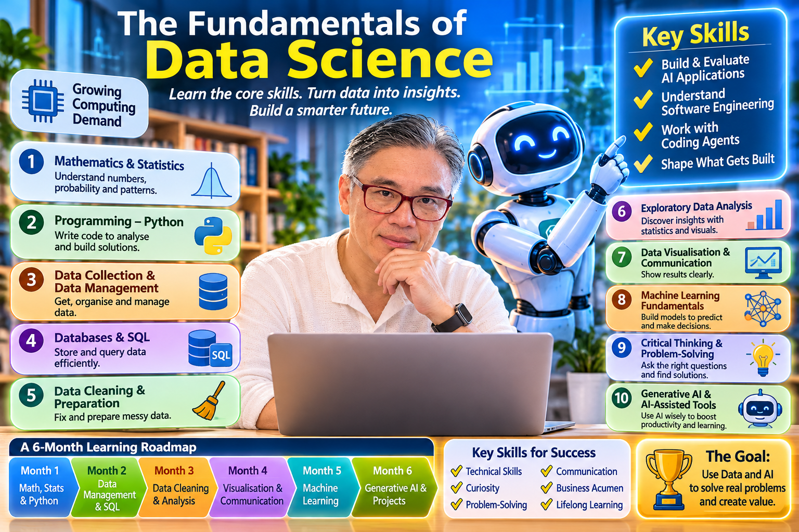

# The Fundamentals of Data Science

Data Science is the discipline of using data to understand problems, discover patterns, make predictions and support better decisions.

A student who wants to become a Data Scientist should not begin by learning every AI tool or memorising machine-learning algorithms. The best foundation is to understand how data is collected, organised, analysed, interpreted and used to solve real-world problems.

I would divide the fundamentals into 10 essential areas, arranged from foundational knowledge to more advanced applications.
## 10 Fundamentals of Data Science Every Student Should Learn
## 1. Mathematics and Statistics

Mathematics and statistics provide the foundation for understanding data, identifying patterns and evaluating whether conclusions are reliable.
    Students do not need to become mathematicians, but they should understand the concepts behind the techniques they use.

### Important topics
- Descriptive statistics: mean, median, mode, variance and standard deviation.
- Probability: likelihood, random events and probability distributions.
- Inferential statistics: samples, populations and statistical conclusions.
- Hypothesis testing: determining whether an observed difference is meaningful.
- Correlation and causation: understanding why two variables move together and whether one actually influences the other.
- Linear algebra: vectors, matrices and basic matrix operations.
- Calculus: basic derivatives and gradients, particularly for understanding machine learning.
> **Practical example:** A supermarket wants to understand why sales are falling. Students should be able to calculate average sales, identify changes over time and determine whether the decline is statistically meaningful.
## 2. Programming – Python

Python is one of the most widely used programming languages in Data Science. It allows students to manipulate data, automate analysis, build models and create applications.

### Important topics
- Variables and data types.
- Lists, dictionaries, tuples and sets.
- Conditional statements and loops.
- Functions and reusable code.
- Reading and writing files.
- Error handling and debugging.
- Object-oriented programming fundamentals.
- Working with libraries and packages.
### Essential Python libraries
| Library | Main purpose |
| --- | --- |
| NumPy | Numerical computing |
| Pandas | Data manipulation |
| Matplotlib | Data visualisation |
| Seaborn | Statistical visualisation |
| Scikit-learn | Machine learning |
| SciPy | Scientific and statistical computing |

> **Practical example:** Use Python to calculate monthly revenue from thousands of sales transactions rather than calculating each transaction manually.
## 3. Data Collection and Data Management

Data Science begins with data. Students must understand where data comes from, how it is collected and how it is stored before analysing it.

### Important topics
- Structured and unstructured data.
- Primary and secondary data sources.
- Surveys and questionnaires.
- APIs and web-based data collection.
- CSV, Excel, JSON and database formats.
- Data types and data structures.
- Data quality and data governance.
- Data privacy and security.
> **Practical example:** Collect customer feedback through an online survey, store the responses and prepare them for analysis.
## 4. Database Management and SQL

Most organisations store information in databases. SQL (Structured Query Language) allows Data Scientists to retrieve, combine and analyse information stored in these systems.

### Important topics
- Relational database concepts.
- Tables, rows and columns.
- Primary keys and foreign keys.
- SELECT, WHERE and ORDER BY.
- GROUP BY and aggregate functions.
- JOIN operations.
- Subqueries and Common Table Expressions (CTEs).
- Database design and normalisation.
> **Practical example:** A bank may have millions of customer transactions. SQL allows a Data Scientist to identify customers with the highest transaction volumes or analyse spending patterns by location.
## 5. Data Cleaning and Data Preparation

Real-world data is rarely perfect. It may contain missing information, duplicate records, inconsistent formats or incorrect values.

Data cleaning is one of the most important practical skills in Data Science.

### Important topics
- Identifying missing values.
- Removing duplicate records.
- Correcting inconsistent data.
- Detecting outliers.
- Converting data types.
- Combining datasets.
- Handling inaccurate or incomplete information.
- Preparing data for analysis and machine learning.
> **Practical example:** A customer database may contain multiple spellings of the same city, missing telephone numbers and duplicated customer records. Students must learn how to identify and handle these issues.
## 6. Exploratory Data Analysis (EDA)

Exploratory Data Analysis is the process of examining data to understand what it contains, identify patterns and discover relationships before building predictive models.

### Important topics
- Summary statistics.
- Frequency distributions.
- Histograms and box plots.
- Scatter plots.
- Correlation analysis.
- Trend analysis.
- Identifying unusual patterns.
- Asking meaningful questions about data.
> **Practical example:** A university analyses student performance data to discover whether attendance, study hours or assignment completion are associated with examination results.
## 7. Data Visualisation and Communication

Data analysis is valuable only when people can understand and act on its findings. Data Scientists must communicate complex information clearly through charts, dashboards and reports.

### Important topics
- Choosing the right chart for the data.
- Bar charts, line charts and pie charts.
- Histograms and scatter plots.
- Dashboards and interactive visualisations.
- Storytelling with data.
- Presenting insights to non-technical audiences.
### Tools to learn
- Microsoft Excel.
- Power BI.
- Tableau.
- Python Matplotlib and Seaborn.
> **Practical example:** Instead of giving management a spreadsheet containing 100,000 sales records, present a dashboard showing sales trends, customer segments and underperforming products.
## 8. Machine Learning Fundamentals

Machine Learning enables computers to identify patterns in data and use those patterns to make predictions or recommendations.

Students should understand the difference between three major categories:

### A. Supervised learning

The model learns from examples that already have known answers.

Examples:
- Predicting house prices.
- Identifying fraudulent transactions.
- Predicting whether a customer will leave a company.
### B. Unsupervised learning

The model discovers patterns in data without predefined answers.

Examples:
- Grouping customers by purchasing behaviour.
- Discovering customer segments.
- Identifying unusual patterns.
### C. Reinforcement learning

The model learns through actions, feedback and rewards.

Examples:
- Training robots.
- Developing game-playing systems.
- Optimising decisions in simulated environments.
Important algorithms to understand:
- Linear regression.
- Logistic regression.
- Decision trees.
- Random forests.
- K-means clustering.
- K-nearest neighbours.
- Basic neural networks.
### Students should also learn
- Training and testing datasets.
- Overfitting and underfitting.
- Model evaluation.
- Accuracy, precision, recall and F1-score.
- Cross-validation.
- Feature engineering.
## 9. Critical Thinking, Business Understanding and Problem-Solving

This is one of the most important areas, yet it is often overlooked in technical education.

Data Science is not simply about applying algorithms. It is about identifying the right problem and using evidence to make better decisions.

Students should learn to ask:
- What problem are we trying to solve?
- Why is this problem important?
- What data do we need?
- Is the available data reliable?
- What assumptions are we making?
- Does the analysis actually answer the question?
- What action should the organisation take?
> **Practical example:**

A retailer notices that sales have declined.

A weak approach is to immediately build a machine-learning model.

A stronger approach is to investigate:
- Which products experienced declining sales?
- Did customer numbers decrease?
- Did prices change?
- Are competitors offering better prices?
- Did customer purchasing behaviour change?
- Is the decline seasonal?
The objective is not to build the most complicated model. It is to understand the business problem and find a useful solution.
## 10. Generative AI and AI-Assisted Data Science

Modern Data Science students should understand how to work with generative AI tools and AI agents. These tools can accelerate coding, data exploration, documentation and analysis.

### Important topics
- Using AI assistants for Python and SQL.
- Understanding large language models (LLMs).
- Prompting and providing useful context.
- Using AI to explore datasets.
- Generating and debugging code.
- Understanding hallucinations and incorrect outputs.
- Evaluating AI-generated analysis.
- Data privacy and responsible AI use.
- Introduction to retrieval-augmented generation (RAG) and AI agents.
**The important principle is that students must understand the work being performed by AI.** They should not blindly accept generated code, calculations or conclusions.

AI should accelerate learning and productivity, not replace fundamental knowledge.

## Recommended Learning Roadmap
A student should learn these subjects progressively rather than attempting to master everything at once.
### A 6-month Data Science foundation programme
#### 1. Month 1 – Mathematics, Statistics and Python
   
   Learn descriptive statistics, probability, Python programming and basic numerical operations.
*Foundation*
#### 2. Month 2 – Data Management and SQL
   
   Learn databases, SQL queries, data collection and file management.
#### 3. Month 3 – Data Cleaning and Exploratory Analysis
   
   Practise using Pandas, NumPy and statistical methods to understand real datasets.
#### 4. Month 4 – Data Visualisation and Communication
   
   Build dashboards, create charts and learn to explain findings clearly.
#### 5. Month 5 – Machine Learning
   
   Learn supervised and unsupervised learning, model training and evaluation.
#### 6. Month 6 – Generative AI and Practical Projects
   
   Use AI-assisted tools, build an end-to-end Data Science project and present the results.
*Applied skills*

## The Tools a Data Science Student Should Know
| Tool | Why students need it |
| --- | --- |
| Python | Main programming language |
| Jupyter Notebook | Experimentation and analysis |
| Pandas | Data manipulation |
| NumPy | Numerical calculations |
| SQL | Database querying |
| Excel | Spreadsheet analysis |
| Power BI / Tableau | Dashboards and reporting |
| Scikit-learn | Machine learning |
| Git and GitHub | Version control and project portfolios |
| Generative AI tools | AI-assisted learning and development |

## Five Practical Projects Every Student Should Complete
Theory alone is insufficient. Students need to demonstrate that they can solve real problems using data.

### 1. Retail Sales Analysis

Analyse sales transactions, identify best-selling products, study seasonal trends and recommend ways to increase revenue.

### 2. Student Performance Analysis

Examine the relationship between attendance, study time and academic results. Identify students who may need additional support.

### 3. Customer Segmentation

Use clustering techniques to group customers according to purchasing patterns and spending behaviour.

### 4. House Price Prediction

Build a regression model to estimate property prices using location, size, number of rooms and other relevant features.

### 5. Customer Churn Prediction

Build a model to identify customers who may stop using a service and recommend ways to improve retention.

## What Makes a Good Data Science Graduate?
A good Data Science graduate should develop a balanced combination of technical and human capabilities.
| Technical capabilities | Human capabilities |
| --- | --- |
| Python programming | Critical thinking |
| Statistics and mathematics | Problem-solving |
| SQL and databases | Communication |
| Data cleaning | Curiosity |
| Data visualisation | Business understanding |
| Machine learning | Ethical judgment |
| AI tools | Continuous learning |

## My Recommendation: What Should Students Prioritise?
If students have limited time, I would prioritise these six capabilities:
1. Statistics: Understand what data tells us and what it does not tell us.
2. Python: Learn how to work with and analyse data.
3. SQL: Learn how to retrieve and manage information.
4. Data visualisation: Learn how to communicate findings.
5. Machine learning: Understand how predictive models work.
6. Critical thinking: Learn how to turn analysis into meaningful decisions.
The first five provide technical foundations. The sixth determines whether those technical skills are applied effectively.

The ultimate goal of Data Science education should not be to produce students who can simply write Python code or operate machine-learning software. It should be to develop people who can identify meaningful problems, work confidently with data, evaluate evidence, use AI responsibly and make better decisions.

That is what makes a student genuinely valuable in an increasingly data-driven and AI-enabled world.
