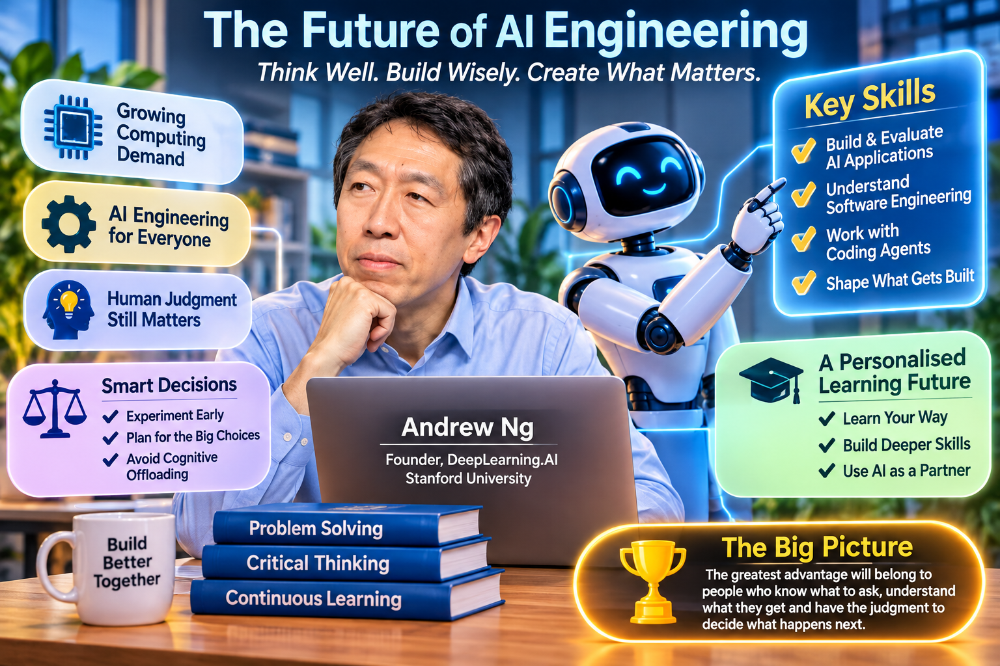

# The Future of AI Engineering: Why Human Skills, Critical Thinking and Judgment Matter More Than Ever

## Introduction

Artificial intelligence is changing how software is created, how businesses operate and how people approach their work. Tasks that once required specialist knowledge, significant time and large teams can increasingly be completed with the assistance of AI tools. Coding agents can generate software, help identify errors, explain unfamiliar technologies and carry out complex sequences of tasks. As these capabilities improve, the way people contribute to technology and business is changing.

It may seem that increasingly capable AI systems will make human expertise less important. In reality, the opposite may be true in many areas. When producing software becomes easier, the ability to decide what should be built, understand the problem, evaluate the results and make sound decisions becomes more valuable.

The future of work will therefore depend not only on how effectively people use AI, but also on how well they combine it with human judgment, technical understanding, creativity and continuous learning.

## 1. The Growing Demand for Computing Infrastructure

The expansion of AI is creating enormous demand for computing infrastructure. Developing and operating AI systems requires powerful data centres, processors, storage systems and databases. This demand comes from two major activities: **AI training** and **AI inference**.

Training is the process of teaching an AI model to recognise patterns and produce useful outputs by exposing it to large amounts of data. It can require substantial computing resources, particularly when developing large models.

Inference happens when a trained model is used to answer a question, generate content, analyse information or perform a task. Every time someone interacts with an AI application, computing resources are needed to produce the response.

However, the demand for infrastructure may extend beyond people directly using AI applications. As AI agents become more capable, they will increasingly perform tasks on behalf of individuals and organisations. An agent might search databases, compare information, update records, generate reports or coordinate several other agents to complete a larger task.

Unlike a human, who can only examine a limited amount of information at a time, an agent can potentially process large volumes of data and repeat operations continuously. This could increase demand for computing, storage and database services.

The implication is that AI is not simply creating demand for better models. It is also changing how the wider technology infrastructure is used. Businesses will need systems that can support more automated activity, larger data workloads and increasingly complex interactions between software agents.

## 2. AI Engineering Is Becoming a Broadly Valuable Skill

AI engineering should not be understood as a job title reserved for people who specialise in artificial intelligence. It is increasingly a practical skill set that can benefit professionals across many roles, including software development, front-end and back-end engineering, mobile development, DevOps and other technology-related disciplines.

The ability to build applications with AI is becoming useful because AI can be incorporated into many existing products and business processes. A developer who understands how to use AI effectively can potentially solve a wider range of problems and contribute to more stages of a project.

Four broad capabilities are particularly important.

### 2.1 Building and deploying AI applications

Traditional software generally follows rules that developers define. If the same inputs and conditions are provided, the software is usually expected to behave in a predictable way.

AI applications are different because their outputs can be uncertain. A language model may respond differently to similar questions, misunderstand instructions or produce information that sounds convincing but is incorrect. An AI application may work well in one situation and fail in another.

This uncertainty changes how applications need to be developed and maintained.

Developers must learn to test AI systems systematically, monitor their performance and identify recurring errors. They need to evaluate not only whether an application runs, but also whether its answers are useful, accurate and appropriate.

For example, imagine a customer-service chatbot. A conventional software test might check whether the chatbot opens correctly and displays a response. An AI evaluation must go further: Does it understand the customer's question? Does it provide correct information? Does it know when it cannot answer? Does it avoid exposing private information?

A useful approach is to establish an ongoing evaluation cycle:

1. Define what a good result looks like.
2. Test the application using realistic examples.
3. Identify incorrect, incomplete or inappropriate responses.
4. Investigate why those failures occurred.
5. Improve the application and test it again.
6. Continue monitoring its performance after deployment.

This process is important because AI applications cannot be judged solely by whether their code works. Their actual behaviour must also be examined.

### 2.2 Understanding software engineering fundamentals

AI coding tools can generate large amounts of code, but this does not eliminate the need to understand software engineering.

In fact, technical fundamentals become more important when developers rely on AI to produce or modify software. A person who understands how systems work is better equipped to give an AI agent useful instructions, recognise poor decisions and assess whether its proposed solution is appropriate.

Software engineering involves much more than writing code. It includes understanding system architecture, databases, transactions, testing, security, performance, maintainability and reliability.

Consider a business application that stores customer information. An AI coding agent might quickly create a feature that allows users to update their details. However, the developer still needs to consider important questions:

- What happens if two users update the same record at the same time?
- How is the information protected?
- Can the system recover if an operation fails halfway through?
- Will the feature continue to work as the amount of data grows?
- Could the change unintentionally affect other parts of the application?

These are engineering questions, not simply coding questions.

Good engineering also involves making trade-offs. A system might be faster but more expensive, more secure but less convenient, or easier to build but harder to maintain. Developers need enough understanding to recognise these choices and decide which compromises are acceptable.

Without that knowledge, someone may accept an AI-generated solution without realising that it has introduced problems that will only become visible later.

AI can help produce the implementation, but human understanding is still needed to judge whether the implementation is sound.

### 2.3 Learning to work effectively with coding agents

Coding agents can do much more than autocomplete a line of code. They can help plan tasks, explore unfamiliar codebases, generate features, run tests and make changes across multiple files.

This changes the developer's role. Instead of manually performing every step, developers increasingly need to describe the intended outcome, provide the necessary context, review the agent's work and guide it when problems arise.

Using a coding agent effectively requires more than writing a short prompt. It involves breaking complex tasks into manageable steps, explaining relevant requirements, providing access to appropriate information and checking the results.

For example, asking an agent to "build a booking system" leaves many important details unresolved. A better instruction would clarify who will use the system, what information must be stored, how bookings are confirmed, what happens when a time slot is unavailable and what security requirements apply.

The quality of the result depends heavily on the quality of the problem definition and the feedback provided during development.

As agents become better at handling routine tasks, some forms of detailed instruction may become less necessary. Agents may increasingly be able to coordinate other agents and determine how to carry out standard procedures. Human effort can then shift towards decisions that require context, judgment and responsibility.

### 2.4 Developing the ability to shape what gets built

Perhaps the most significant change is that developers are increasingly able to participate in deciding what should be built, rather than simply implementing instructions created by someone else.

When building software required more time and specialist effort, responsibilities were often divided into narrow roles. Product managers identified requirements, designers developed interfaces and engineers implemented the agreed specifications.

AI tools can reduce the effort required to move between these activities. A developer who previously focused on front-end work may now be able to use AI to create back-end functionality as well. A technically capable developer can also explore product ideas, create prototypes and gather feedback without waiting for every stage to be handled by another person.

This does not mean every developer must become a product manager. It means that understanding the purpose of a product and being able to make sensible decisions about its direction can make technical work more valuable.

This capability can be described as **shaping the build**.

It involves asking questions such as:

- Are we solving a real problem?
- Who will use this product?
- What is the simplest useful version we can create?
- Should we build a prototype or invest in a more robust architecture?
- Do we need more customer feedback before proceeding?
- Which technical approach best fits the project's requirements?
- What risks should be addressed before launch?

The central idea is that building something is not the same as building the right thing. As AI makes implementation faster, choosing the right problem and guiding the development process become increasingly important.

## 3. Why Human Context and Judgment Still Matter

AI systems can process large amounts of information, recognise patterns and generate useful recommendations. However, they do not automatically possess all the context that people accumulate through experience.

A person working on a product may remember a conversation with a customer, notice hesitation during a demonstration or recall a market insight from a report read several years earlier. These details may appear minor, but together they can influence an important decision.

For example, customer feedback is not always expressed directly. A customer might say that a feature is useful while showing little enthusiasm when using it. An experienced employee may recognise that the feature is not addressing the customer's most important concern.

Similarly, a business decision may depend on factors that are not recorded in a database: internal relationships, organisational priorities, contractual commitments, the history of a project or an understanding of what customers are unlikely to accept.

AI can help organise and interpret information, but it may not have access to all these details. Even when relevant information is available, deciding how much weight to give it can require human judgment.

This is why providing AI with the right context is so important. People who understand their customers, business environment and organisational goals can guide AI towards more useful outcomes.

The most effective working relationship is therefore not necessarily one in which AI replaces human involvement. It is one in which AI handles tasks it can perform well while people contribute context, direction and judgment.

## 4. Making Better Decisions About How to Build

One of the most important skills in AI-assisted development is knowing how much planning a project needs before implementation begins.

There is no single answer. The right approach depends on the project's stage, the consequences of failure and how difficult it would be to reverse a decision.

A useful distinction is between **two-way-door decisions** and **one-way-door decisions**.

A two-way-door decision is relatively easy to reverse. If an early prototype uses the wrong layout or an experimental feature does not work, the team can change direction without major consequences.

A one-way-door decision is much harder or more expensive to reverse. Examples may include choosing a foundational architecture for a large system, exposing sensitive information, committing to a major infrastructure investment or making a change that affects important business operations.

### Experiment quickly when the cost of failure is low

During the early stages of a project, it is often useful to build a simple prototype and learn from the result.

Rather than spending weeks designing a system based on assumptions, a team can use an AI coding agent to create a basic version, test it and discover what needs to change.

A prototype does not need to be perfect. Its purpose is to answer questions quickly:

- Does the idea make sense?
- Can users understand the product?
- Does the proposed feature solve the intended problem?
- Are there technical obstacles that were not anticipated?

Experiments are valuable because they replace speculation with evidence.

However, experimentation must still be responsible. Sensitive information should not be exposed, security protections should not be ignored and prototypes should not be mistaken for production-ready systems.

### Plan carefully when the consequences are significant

As a project matures, the cost of changing direction may increase. More users, data, integrations and business processes may depend on the system.

At this stage, greater attention should be given to architecture, security, reliability, scalability and long-term maintenance.

For example, a prototype that stores test information locally may be perfectly acceptable during experimentation. A production application containing customer records requires a much more careful approach to data protection, access control, backups and reliability.

The principle is straightforward: move quickly when decisions are reversible, but slow down when mistakes could create serious or lasting consequences.

AI makes it easier to produce software quickly. It does not remove the need to decide when speed is appropriate.

## 5. The Risk of Becoming More Productive but Less Capable

One of the less obvious risks of AI adoption is that people may become more productive while gradually losing opportunities to develop their own abilities.

This is a form of **cognitive offloading**: transferring mental work to an external tool instead of performing it ourselves.

For example, a student who asks an AI system to solve every mathematics problem may finish homework more quickly. However, if the student does not attempt the problems independently, they may struggle to solve similar questions during an examination.

The same issue applies to working professionals.

A developer who asks an AI agent to write every function may complete more tasks in less time. But if the developer never examines the logic, investigates errors or learns why a solution works, their understanding may not improve at the same rate as their output.

Over time, this creates a potential gap between what a person can produce with AI assistance and what that person can understand or accomplish independently.

The danger is not that people use AI. The danger is using it in ways that remove the thinking required to learn.

### Use AI as a learning partner, not just an answer machine

AI can also improve learning when it is used deliberately.

Instead of immediately asking for a complete answer, a learner can ask for a hint, request an explanation of a difficult concept or attempt a solution before asking the AI to review it.

For example, a developer learning database design could:

1. Attempt to design the database independently.
2. Ask AI to identify possible weaknesses.
3. Explain the reasoning behind the proposed changes.
4. Compare different design approaches.
5. Apply the ideas to a new problem without assistance.

This approach makes AI part of the learning process rather than a replacement for it.

A useful rule is to let AI reduce unnecessary effort without eliminating the intellectual effort that builds understanding.

People should remain actively involved in questioning, reasoning, evaluating and reflecting. The objective should not simply be to finish more work, but to become better at doing the work.

## 6. The Future of Education: From Standardised Courses to Personalised Learning

Traditional education often follows a one-to-many model. A teacher delivers the same lesson to a group of students, or an online course provides the same material to thousands of learners.

This approach has significant advantages. It makes education accessible and allows high-quality material to reach a large audience. However, it cannot always respond to the individual needs of every learner.

Students have different backgrounds, levels of knowledge, learning speeds and areas of difficulty. A person who already understands a concept may find a standard lesson too slow, while someone encountering it for the first time may need more explanation and practice.

AI creates opportunities for a more personalised, one-to-one learning experience.

An AI tutor could adjust its explanations based on a learner's progress, identify gaps in understanding, generate additional exercises and provide feedback tailored to the learner's needs.

For example, when teaching programming, an AI tutor could recognise that a student understands basic syntax but struggles with problem decomposition. Instead of repeating the entire lesson, it could provide exercises that focus specifically on breaking problems into smaller steps.

This could make learning more flexible and responsive.

However, personalisation alone does not guarantee effective education. An AI tutor that simply gives students completed answers may increase convenience without improving understanding.

Good educational AI should encourage active learning. It should ask questions, provide hints, challenge assumptions and help learners discover solutions themselves.

The long-term opportunity is not merely to make information easier to access. It is to help more people develop deeper knowledge and practical abilities.

## 7. A Practical Approach to Developing AI Engineering Skills

Developing AI engineering capability does not require someone to master every tool or technology immediately. A more effective approach is to build practical experience while strengthening the underlying skills.

The following four-week programme provides a starting point.

### Week 1: Understand the fundamentals and explore AI tools

Begin by learning how AI applications and coding agents work. Explore how to provide instructions, supply context, break tasks into smaller steps and review generated outputs.

Choose a small project, such as a personal task tracker, a simple information-search tool or a basic customer enquiry application.

The objective is not to build something impressive. It is to understand the development process and become comfortable working with AI.

### Week 2: Build and evaluate an AI-powered application

Develop a simple application that uses an AI model to perform a useful task.

Pay attention to the fact that AI outputs are not always predictable. Test the application with different inputs, including unclear or unexpected questions.

Record where it performs well and where it fails. Learn how to improve the system through better instructions, application design, testing and evaluation.

### Week 3: Strengthen software engineering and system design

Examine the technical foundations of the application.

Consider how information is stored, how different components communicate and how the system handles errors. Review security, privacy, performance and reliability.

Ask an AI coding agent to explain its design decisions, but do not accept its recommendations automatically. Compare alternatives and try to understand the consequences of each choice.

The goal is to become capable of evaluating AI-generated work rather than simply accepting it.

### Week 4: Practise product judgment and independent problem-solving

Improve the application based on feedback from potential users.

Identify which features are genuinely useful, which are unnecessary and what should be improved next. Consider whether the application solves a meaningful problem and whether it is reliable enough for its intended use.

Finally, complete a small task without relying entirely on AI. This helps reveal which concepts have been understood and which still require practice.

Throughout the four weeks, continue building. Practical experience is essential because AI engineering is not just a theoretical subject. It is a collection of skills developed through repeated experimentation, evaluation and improvement.

## 8. What These Changes Mean for Businesses and Professionals

AI is likely to change the way organisations structure work and evaluate employee contributions.

When individuals can use AI to complete tasks that previously required several people or specialist teams, traditional job boundaries may become less rigid. Employees may be able to contribute across a wider range of activities.

A software developer may become more involved in product decisions. A business analyst may use AI to build working prototypes. A marketing professional may automate research and content workflows. A manager may use agents to collect information and prepare analysis before making decisions.

This does not mean that specialist knowledge becomes unnecessary. Rather, specialists who combine their expertise with AI capabilities may be able to create greater value.

Organisations will also need to rethink how they measure productivity. Counting the number of tasks completed or lines of code produced may become less meaningful when AI can generate output rapidly.

More useful measures include whether the work solves the right problem, improves customer outcomes, reduces operational risk and creates sustainable business value.

Businesses should therefore invest in more than AI tools. They need to develop employees who can use those tools responsibly, understand their limitations and make good decisions about where they should be applied.

## Conclusion: The Future Belongs to People Who Can Think Well with AI

AI is making it easier to create software, automate processes and access knowledge. These capabilities are transforming what individuals and organisations can accomplish.

Yet the ability to produce more output does not automatically translate into better results. Someone still needs to identify the right problem, understand the people affected by it, choose an appropriate solution and evaluate whether the outcome is successful.

The most valuable professionals will therefore combine technical competence with critical thinking, product awareness, communication and sound judgment. They will know how to work with AI agents, but also when to question their recommendations, when to intervene and when a decision requires careful human consideration.

There is also a personal responsibility to keep learning. AI should help people become more capable, not merely more dependent. Using it to explore unfamiliar ideas, test assumptions and receive feedback can accelerate development. Using it to avoid thinking altogether can weaken the very abilities that make people valuable.

The future of AI engineering is not simply about machines doing more work. It is about people learning to direct increasingly capable systems towards meaningful goals.

**The greatest advantage will not necessarily belong to those who use AI the most, but to those who know what to ask of it, understand what it produces and have the judgment to decide what should happen next.**
