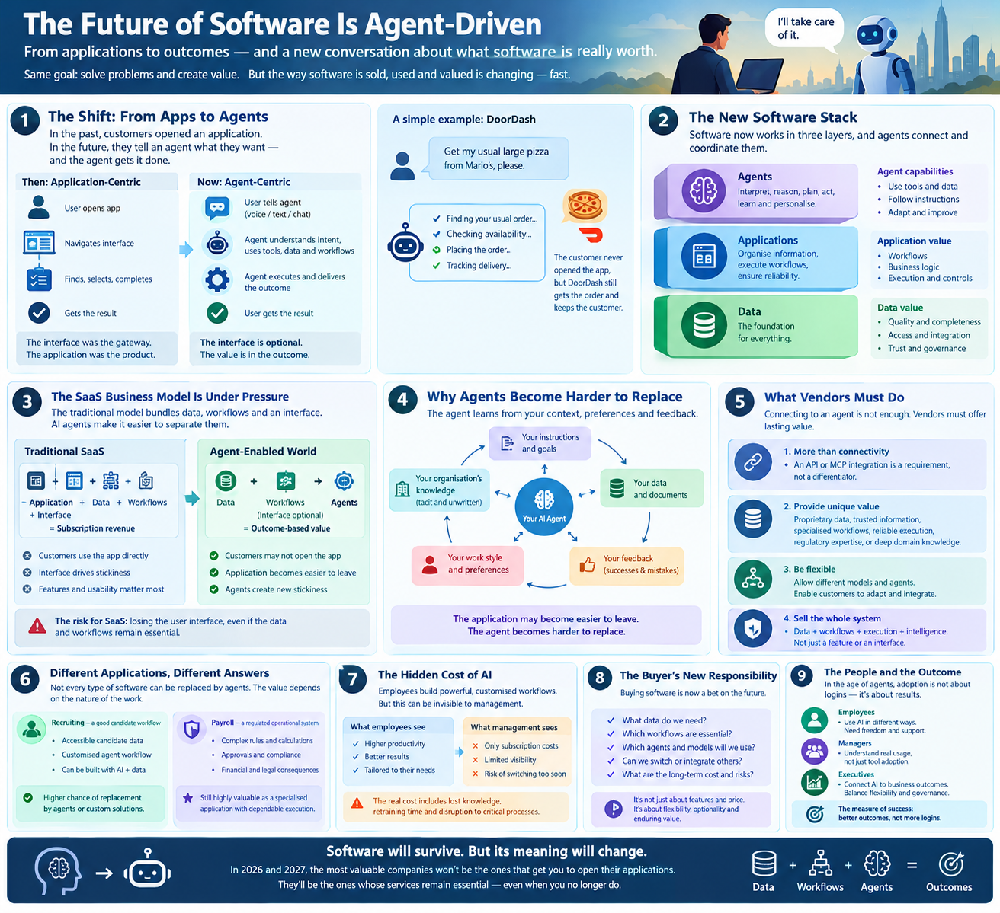

*How AI agents are rewriting the economics of SaaS in 2026 and 2027*

The interface is no longer where software earns its money. For two decades, software companies won by pulling users into an application, charging per person for access and making the product hard to leave. AI agents break all three: the interface becomes optional, the per-seat price loses its logic, and lock-in moves from the application to whatever surrounds the agent. The argument of this article is that the software companies that last will be those whose data, execution and trustworthiness remain valuable when nobody opens their app.

## 1. DoorDash and the Disappearance of the Interface

What if the future of enterprise software could be understood by looking at a company that sells sandwiches?

On 30 September 2026, DoorDash opened a waitlist for a beta of text-based ordering. US customers on iPhone can message its Ask DoorDash assistant through Apple Messages and ask for a particular dish, a local recommendation or simply their usual order. The assistant searches menus, proposes a cart and completes checkout inside the conversation. Reports put the initial pilot at around 20,000 users.

On the same day the company opened a waitlist for DoorDash MCP, a Model Context Protocol connector for corporate ordering, so that workplace AI tools and messaging platforms can place group meal and office-supply orders. A command-line beta for individual developers building personal agents had already opened in July. DoorDash’s co-founder described agents as a new app paradigm.

DoorDash’s text ordering is still a waitlisted beta, but it is the clearest consumer signal yet of where this is heading.

Even so, the direction is clear. DoorDash does not need customers to open its application to stay relevant. It needs to keep its place in the transaction. Whether the order starts in its own app, a text thread or an external assistant, it can still fulfil the order and earn revenue. The interface, once the primary gateway to the customer, becomes optional.

For decades, software companies competed to attract users into their applications, keep them there and charge for the functionality inside. The application was the product, and the user was expected to learn its particular way of doing things. Agents reverse that relationship. Instead of users navigating software, software becomes something agents navigate on their behalf. The customer describes an outcome; the agent works out how to achieve it.

### What DoorDash Really Shows

DoorDash is the right opening because it is concrete and it isolates the point. The company that owns fulfilment can lose the interface and still keep the transaction.

But it also exposes the threat. When an outside agent decides where to order, DoorDash has to win that decision on price, speed and availability, not on habit. That it is building its own agent while opening its services to others suggests the interface alone is no longer a moat.

That is the real lesson. Losing the interface does not mean losing the customer, but it ends the assumption that the customer is yours by default. Whoever sits between the customer and the service captures the relationship, and every software company must now decide whether it is the agent, the service behind the agent, or neither.

## 2. The Market Has Already Noticed

This is not only a thought experiment. In early 2026, software shares fell sharply in what commentators dubbed the “SaaSpocalypse”. Estimates of the value lost vary widely depending on the source and the period measured, and the panic has since cooled, so any single figure should be treated with caution.

What matters is the logic investors were repricing. If an agent can do work that a person previously did inside a licensed seat, the vendor’s revenue, which scales with the number of seats, is exposed even if the software itself is excellent.

The reaction was also uneven. Categories where agents can plausibly perform the same tasks were hit hardest, while systems that hold critical records or execute regulated processes were treated more gently. That distinction runs through the rest of this article.

## 3. The SaaS Model Comes Under Pressure

The traditional software-as-a-service model rests on a simple proposition. A company builds an application that performs a function, charges a recurring subscription and keeps improving the product. Customers return because it helps them do their work.

But consider how much of that work consists of finding information, arranging it into a useful form and acting on it. A recruiter searches for candidates, copies details into a spreadsheet, compares qualifications and prepares a shortlist. A salesperson reviews a customer record and correspondence and prepares an account plan. An engineer searches documentation, inspects code and assembles information from several tools.

Much of this is information processing rather than an indispensable interaction with the application. An agent can increasingly do it by connecting to the relevant data sources, applying instructions and producing a result. The employee reviews the output and approves the next action. Over time, the employee may stop opening the original application at all.

The application has not necessarily become useless. Its data may remain essential and its functions may keep running. What has diminished is the interface as the place where work gets done.

This exposes a weakness in many SaaS propositions. They bundle four distinct things: access to information, the organisation of that information, the workflows that operate on it, and the interface through which people use the system. While customers had to use the application directly, the bundle held together. Agents make it easier to pull it apart.

## 4. From Seats to Outcomes: The Pricing Problem

The most direct economic consequence is on price. Per-seat pricing assumed that more employees meant more licences. If one person supervising agents does the work of several, the number of seats shrinks while the value delivered may rise. A vendor billing by the user faces a contraction in addressable revenue regardless of how good its product is.

Vendors are responding in several ways:

- **Usage-based pricing** charges for what is consumed, such as tasks, tokens or workflow runs.
- **Outcome-based pricing** charges only when a defined result is delivered. Zendesk began billing per automated resolution in 2024, and Intercom’s Fin agent is priced at \$0.99 per resolved conversation.
- **Hybrid pricing** combines a base subscription with usage or outcome components. This is where most of the market appears to be landing, rather than at pure outcome pricing.

Forecasts point the same way. Gartner predicts that by 2030 at least 40 per cent of enterprise SaaS spending will move from per-seat pricing towards usage, agent or outcome models. Other industry estimates suggest hybrid models already account for a large minority of SaaS vendors, though the precise shares differ between sources.

Outcome pricing is attractive in principle, but hard in practice:

- **Defining the outcome.** What counts as a “resolved” ticket or a “qualified” candidate? Both sides have incentives to define it generously or narrowly.
- **Attribution.** If a human and an agent both contributed, who earned the fee?
- **Margins.** Every agent action consumes model inference, so vendors who charge a fixed price per outcome carry the cost risk. Software gross margins, historically very high, may come under pressure.
- **Predictability.** Buyers who liked a fixed annual bill may dislike a variable one, so many will want caps and conversion rights between pricing models.

The practical consequence is that “what are we paying for?” becomes the central question of every software negotiation.

## 5. The Agent Becomes the New Source of Stickiness

The more interesting consequence is that the application may lose its grip on the customer while the agent acquires a stronger one.

Consider a recruiter who begins using an agent to prepare shortlists. Initially it retrieves profiles, compares experience and drafts recommendations. But the recruiter gradually teaches it what a good candidate looks like for different roles, which qualifications matter most, which candidates are unlikely to fit and what individual hiring managers prefer. The agent folds these lessons into its instructions, tools and accumulated context.

Eventually it knows much more than the formal job description. It understands the organisation’s practical conventions, including preferences and exceptions that were never documented.

The recruiting application may still supply valuable data, but the agent has become the repository of the customised workflow. If management replaces the AI provider, the apparent saving may conceal a substantial cost: the new agent may have the same database but not the accumulated instructions, context and feedback that made the old one effective.

The traditional source of lock-in is therefore shifting. Customers were once tied to an application because their data, processes and habits lived inside it. Increasingly they may be tied to an agent because their knowledge of how to work effectively lives in its surrounding system. The application becomes easier to leave, while the AI arrangement built around it becomes harder to replace.

This lock-in is not inevitable. It depends on whether instructions, memories, tools and workflow definitions can be exported and moved between agents. An organisation that deliberately keeps these assets in portable formats can avoid much of the dependency. But a company may build a critical process around an AI system without ever recognising that system as essential infrastructure.

## 6. Three Layers Will Determine the Future of Software

It helps to divide the software environment into three layers.

**The data layer** holds the information on which work depends: customer records, financial transactions, candidate profiles, specifications and correspondence. Its value lies in quality, completeness, relevance, reliability and accessibility. For many businesses this is also the system of record, the authoritative source that others must defer to.

**The application layer** provides the systems and workflows that organise information and turn it into dependable operations: payroll, customer management, accounting, recruitment and engineering tools. It may include an interface, though the interface need no longer be the main way in.

**The agentic layer** supplies the intelligence that interprets instructions, retrieves information, coordinates tools, executes tasks and adapts workflows to individual users and organisations.

A fourth concern cuts across all three: **trust**. Who is allowed to do what, on whose behalf, with what audit trail, and who is accountable when something goes wrong? Section 10 returns to this.

The layers overlap but perform different economic functions. An agent can make a conventional interface less necessary without removing the need for the underlying data. It can cut the cost of building a customised workflow without removing the need for a reliable system that executes it correctly.

The strategic question for every software company is where it sits among these layers, what value it contributes to each and how easily that value can be substituted. A vendor whose main advantage is an attractive interface may face serious pressure. A vendor with unique data, deeply embedded workflows or dependable execution may be far better placed.

For buyers the framework matters just as much. Purchasing is no longer only a comparison of features, prices and user experience. It requires assessing the whole arrangement: where the data lives, which workflows are essential, which agents act on the information and how readily each component can be changed.

## 7. Why Salesforce and Microsoft Are Better Positioned Than They Appear

The transformation does not doom every established vendor. Companies with enterprise distribution, trusted infrastructure and deeply embedded data may hold substantial advantages.

Salesforce illustrates the case for. Its systems contain years of customer histories, sales activity and organisational process, information with latent value beyond the purpose the original application served. As models improve, agents can use it to prepare account plans, spot opportunities and summarise customer interactions. Salesforce’s challenge is to stay valuable as the way people reach its data changes, by offering its own agents while also letting external ones work with its systems.

Microsoft combines cloud infrastructure, enterprise data, developer tools and familiar applications such as Outlook and Excel. As agents take over information-processing tasks, users may touch these products less directly, yet the underlying information, infrastructure and relationships remain valuable. Microsoft can integrate AI across its products and position itself as a trusted environment in which organisations deploy and govern agents.

Their advantage has a price. Both companies earn much of their revenue from seats, so the better their agents become, the more they erode the base that funds them. The winners among incumbents will be those that accept this and reprice around outcomes before agents force the issue. Data and distribution give them a head start, not a guarantee, and the head start is worth only what they turn it into: agent-era value, not AI features bolted onto products designed for an earlier era.

## 8. The AI Laboratories Face a Different Strategic Problem

Companies such as OpenAI and Anthropic begin from a different position. They generally lack the customer-specific business data and established corporate distribution that enterprise vendors have. Their proposition is intelligence: the ability to reason, interpret instructions and improve as models advance. Their challenge is to turn that into a durable enterprise relationship.

One route is partnership. The model developer supplies intelligence; a software provider supplies data, workflows, infrastructure and customer relationships. Both gain, and customers gain choice. A business may want one model for one task and another for a different task, and may want to replace a provider when a better or cheaper one appears.

A control layer that lets different agents and models operate within the same enterprise environment reduces dependence on any single vendor. This is the strategic value of optionality. Nobody can confidently assume that today’s leading model will remain the best choice tomorrow, and no business should become dependent on one provider merely because it arrived first.

The more sophisticated software proposition will therefore include not just intelligence but the ability to accommodate different kinds of intelligence. For vendors, interoperability becomes part of the sales argument. For buyers, it preserves bargaining power.

## 9. Connecting to an Agent Is Not Enough

The DoorDash example carries a warning. Making a service accessible to external agents is increasingly necessary, but accessibility is not indispensability.

Suppose two providers offer equally good information and equally reliable execution. If an agent can connect to both with equal ease, the customer can switch between them at will. Having an integration, or an agent of one’s own, does not explain why the customer should keep paying.

There is also a gatekeeper effect. When an agent decides which provider to call, the agent’s operator gains influence over who wins: through ranking, defaults, commissions or preferred partnerships. Vendors that once competed for search placement or app-store visibility may now compete to be the option an agent selects. Being easy to call is the entry ticket, not the prize.

The provider must offer something more: proprietary or especially valuable data, a trusted source, a specialised workflow, superior execution, regulatory expertise or reliability that customers cannot easily reproduce. DoorDash has restaurant relationships, ordering infrastructure and the ability to get food to people. An external agent may change how an order is placed, but it does not replace the network and operations needed to fulfil it.

The same principle applies to business software. An agent can explain a payroll discrepancy, but explaining is not the same as calculating wages correctly, complying with rules, obtaining approvals and ensuring people are paid. A company can build an AI workflow to search for candidates but may still need a specialist provider for reliable structured data. A business can build a custom interface for financial information but may still need an established accounting system to keep records and execute transactions properly.

The distinction is between producing an answer and delivering a dependable outcome. AI makes answers and custom workflows cheaper. It does not make every underlying source of data, operational capability or institutional responsibility equally easy to replace.

## 10. Trust, Security and Accountability

Handing work to agents creates risks that the application model largely avoided.

- **Identity and permissions.** An agent acts on someone’s behalf. Systems need to know which agent, for which person, with what authority, and for how long. Broad, standing access is a larger target than a human login.
- **Manipulation.** Agents that read emails, documents and web pages can be fed hostile instructions hidden in that content. Anything an agent can read, an attacker may try to use to steer it.
- **Accountability.** When an agent places the wrong order, approves the wrong payment or misreads a policy, someone is responsible. Contracts, insurance and regulation have not fully caught up.
- **Auditability.** Regulated processes need a record of what was done, why and on whose authority. Improvised agent workflows often lack one.
- **Human oversight.** The sensible pattern for consequential actions is to let agents prepare and humans approve, at least until reliability is demonstrated. DoorDash’s own caution that its agent may add unrequested items is a small, honest example.

This is also an argument for incumbents. A vendor that can offer permissions, controls, audit trails and clear accountability is selling something that an improvised agent workflow does not provide.

## 11. Why Payroll Is Different From Recruiting

The contrast between recruitment and payroll shows why the application layer cannot simply be declared dead.

Consider a small recruiting business. It may obtain structured candidate data from a specialist provider and use an agent to build its own search and screening workflow. Instead of buying a conventional recruiting application, it combines data with customised instructions and an inexpensive AI-powered process. If the data is accessible and the workflow cheap to build, a packaged application may offer less incremental value than it once did. The vendor’s opportunity may lie in supplying better data and helping customers build on it.

Payroll is different. A payroll system must handle configured rules, employee records, calculations, approvals and compliance. Errors carry direct financial and legal consequences. An agent can explain a payslip, flag an inconsistency or recommend a correction, but that does not mean a company should replace the underlying machinery with a collection of improvised instructions. Here the application is not merely a way to view information. It is a structured system for carrying out consequential operations reliably.

A useful way to place any category is to ask four questions:

1. **How costly is an error?** The higher the cost, the more value sits in dependable execution.
2. **How regulated is the process?** Compliance obligations are hard to improvise.
3. **How unique is the data?** Proprietary or hard-to-collect data stays valuable whoever holds the interface.
4. **How standard is the workflow?** The more generic it is, the easier it is to rebuild with an agent.

On this test, systems of record for finance or health, and regulated processes such as payroll and tax, tend to be sturdier. Generic research, reporting, scheduling and first-line support work tend to be more exposed, which is why customer service is where outcome pricing has moved fastest.

The relevant question is not whether AI can reproduce some of an application’s functions. It is whether the business can reproduce the complete outcome, including reliability, controls, maintenance and accountability, at an acceptable cost. Every category will answer differently. The future will not be a universal contest between AI and SaaS; it will be decided by which parts of each application can be separated, rebuilt or replaced economically, and which remain valuable because they embody specialised knowledge and dependable execution.

## 12. The Hidden Cost of AI: Organisational Lock-In

The transformation also creates a problem inside companies. Employees are already developing personal ways of working with AI. One person uses an agent to analyse sales correspondence, another to review code, a third has built a custom workflow for recruitment or financial reporting. These arrangements can be highly productive, but they are often invisible to management.

An employee may favour a particular provider because its model, memory, tools and accumulated instructions work well together. A manager may see only the subscription cost and conclude a cheaper alternative would do. Finance may then switch vendors in pursuit of savings without understanding what the employee stands to lose.

The visible cost of an AI service is not its total economic cost. A subscription or token bill is easy to measure. The knowledge embedded in a customised workflow, the cost of rebuilding it, the time to regain productivity and the risk of disrupting a business process are not. This creates an information asymmetry between the employee, who understands the value, and management, who sees only part of the equation.

The answer is neither unlimited freedom to choose any AI service, which raises security, privacy, governance and cost problems, nor a ban on experimentation. Organisations should instead make actual AI usage visible. Employees should explain how they use AI, which data it touches, what tasks it performs, where humans still supervise and why the combination works. Managers can then evaluate the workflow rather than merely compare subscription prices, identify reusable methods, document critical instructions and decide which components must be portable across vendors.

An employee’s customised arrangement may become part of the company’s operating capability without ever being formally recognised. The individual is no longer merely a user of software but, in a real sense, a designer of the company’s technology stack.

## 13. Software Buying Becomes a Bet on the Future

When a company buys software in 2026 or 2027 it is not just purchasing what the product does today. It is betting on how the product will evolve as models improve. A compelling demonstration says little about whether the vendor’s long-term position is defensible.

The competitive field has also widened. A software vendor now competes not only with similar applications but with model providers, general-purpose agents, specialist data companies and customers who can build their own solutions. The cost of building has fallen in some areas, making it economical to assemble workflows that once required packaged software. That does not mean every company should build its own. Bespoke systems must be maintained, secured and governed, and engineering time has an opportunity cost.

Procurement becomes an allocation decision: what to buy, what to build, what to connect and what to keep replaceable. Before signing, buyers should ask:

- Does the vendor control valuable, hard-to-replicate data?
- Can other agents access that data, and on what terms and at what price?
- Are the workflows reliable and adaptable?
- Can we bring our own models, and can we export our instructions, memory and workflow definitions?
- How is pricing structured, and can we convert between seats, usage and outcomes as our use of agents grows?
- What controls, audit trails and accountability does the vendor provide when an agent acts?
- What happens to the value proposition when the next generation of models arrives?

## 14. What Software Companies Must Sell Next

Vendors need a value proposition that stays compelling when customers no longer interact with the product in the traditional way. That means moving from selling an interface as the centre of the experience to demonstrating the value of the whole system.

The data must be useful and accessible. The workflows must be dependable. Interfaces must accommodate changing patterns of work. Agentic capabilities must be effective without needlessly excluding other agents. A specialist vendor might provide the best data for a task and help customers build around it. An enterprise provider might differentiate on compliance, reliability and operational depth. A platform company might offer the infrastructure and governance to manage many agents across an organisation.

The strategies differ, but the principle is shared: know precisely where you add value. Announcing that a product is AI-enabled will not be enough, nor will offering an API or MCP integration, though these may be necessary to remain reachable. Interoperability makes a product available to the agent-driven world; it does not make it worth buying.

The winning proposition combines data that matters, workflows that work, execution that can be trusted and intelligence that can evolve, with pricing that tracks the value delivered. The strongest vendors will also let customers use different models, integrate external agents and adapt workflows without rebuilding everything when a new technology arrives. In this environment, selling software means selling confidence that the underlying value will endure even as the way people reach it changes.

## 15. The Future of Work Is About Outcomes, Not Adoption

For years businesses measured technology adoption by how many employees had access to a system and how often they logged in. In the age of agents these measures say less. An employee may stop opening an application while still depending on what it supplies. Another may use an agent to combine several systems into a workflow that delivers better results with less effort. Counting logins would miss the change.

The better questions concern results. Is the business generating more revenue, serving customers better, recruiting better candidates, reducing errors, finishing engineering work faster or improving profitability? AI adoption is becoming the baseline expectation rather than the objective.

This places responsibility on everyone. Employees need to communicate how they use AI and what their workflows accomplish. Managers need to understand their teams’ actual practices rather than assume a centrally selected toolset tells the whole story. Executives need to connect technology spending to measurable outcomes. The aim is not uniformity for its own sake: different teams have different needs, and a sensible strategy preserves the flexibility that makes these arrangements productive while protecting critical knowledge, security and operational controls.

## 16. The Objections, Answered

Sceptics make five serious arguments. Each is true as far as it goes, and none rescues the interface.

- **“Enterprises move slowly.”** True, but slow is not stationary. Seat counts shrink at renewal, one contract at a time. Inertia delays the shift; it does not reverse it.
- **“Agents make mistakes.”** They do, which is why consequential work keeps a human approving. But most information-processing work tolerates error far better than payroll does, and that is exactly where the interface is being bypassed first.
- **“Agents cost real compute.”** Yes, and that is why pricing is moving towards usage and outcomes. The cost is a reason prices change, not a reason the old model survives intact.
- **“Integration is hard.”** Standards such as MCP are lowering that cost quickly, and every vendor that opens up lowers it further for everyone else.
- **“DoorDash is only a beta.”** It is, and so was every channel shift before it became the default. The signal is the direction of investment, not the size of the pilot.

The honest conclusion is not that the transition will be slow, but that it will be uneven: fastest in generic, low-risk, information-heavy work, slowest in regulated and deeply embedded systems. That unevenness is the thesis in action. Value concentrates where execution cannot be improvised.

## 17. A Practical Playbook

**For buyers**

- Map which workflows are essential, which data is critical and which agents already touch both.
- Negotiate portability: export rights for instructions, memory and workflow definitions.
- Seek flexibility in pricing, including the right to move from seats to usage or outcomes.
- Prefer vendors that support several models and external agents.
- Require clear permissions, audit trails and accountability for agent actions.

**For vendors**

- Decide which layer you win in, and be able to say what remains valuable when the interface is bypassed.
- Open your data and functions to agents, but price for the value delivered rather than the access granted.
- Invest in reliability, controls and compliance as products, not overhead.
- Model the margin impact of inference before committing to outcome pricing.
- Expect to be selected by agents, and work out what makes you the choice.

**For managers and employees**

- Make AI usage visible and document the workflows that matter.
- Judge tools by outcomes, not logins or subscription cost alone.
- Keep humans approving consequential actions until reliability is proven.

## 18. What to Watch Over the Next Twelve Months

- Whether text and agent-based ordering at consumer companies such as DoorDash moves from waitlist beta to general release, and how often outside agents are allowed to place orders.
- How quickly incumbents shift from seats to hybrid and outcome pricing, and what happens to their margins.
- Whether agent memory and instructions become portable across providers, or remain a source of lock-in.
- How agent identity, permissions and liability are handled in contracts, standards and regulation.
- Whether agents become the new gatekeepers, ranking and favouring some vendors over others.
- Which categories lose seats fastest, and which prove resilient.

## Conclusion: Software Will Survive, but Its Meaning Will Change

The future of software is not a world without applications. It is a world in which the interface loses its privileged position, the seat loses its pricing power and the agent becomes a new centre of gravity.

DoorDash shows the principle in simple form: customers can order without opening the app, and the company can keep the transaction because it provides the service that matters, provided it continues to be the provider an agent chooses. Enterprise software faces the same test, with more complicated answers. Some vendors will find their interfaces and packaged workflows reproduced cheaply. Others will find their data more valuable as agents learn to use it. Still others will remain indispensable because they run complex workflows that require dependable execution, specialised knowledge and robust controls.

Organisations will also meet a new form of dependence. The customised agent that makes an employee exceptionally productive may be harder to replace than the applications it uses, so the cost of changing AI vendors includes lost organisational knowledge as well as money.

The decisive question is no longer whether a company has an application, has added AI or can connect to an external agent. It is whether the combination of its data, workflows, intelligence and trust delivers an outcome that customers cannot easily obtain elsewhere.

Software is not disappearing. Its economic foundations are being rearranged. And in that rearrangement, the most valuable companies may not be those that persuade customers to keep opening their applications, but those whose services remain essential even when customers no longer open them at all.

---

*Notes on sources.* DoorDash details are drawn from trade and technology press coverage of its 30 September 2026 announcement. Pricing and market figures (Gartner’s 2030 forecast, hybrid-pricing shares, the early-2026 sell-off and vendor surveys) come from secondary sources of varying quality and should be checked against primary sources before publication.
