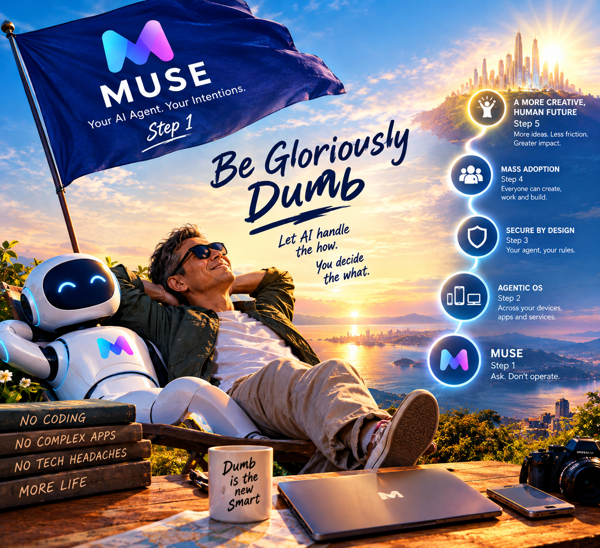

# The Glorious Pursuit of Being Dumb

*MUSE Is Step 1 in the Revolution That Will Set Us Free from Knowing How*

Windows and macOS were supposed to make computers easy. Decades later, we are still wrestling with files, folders, settings, permissions, updates, and a thousand small technical humiliations. They promised simplicity and delivered homework. **They have failed, miserably, at making computing effortless.**

So let us hope that AI becomes the crown atop these operating systems, finally letting them do what they were always supposed to do: serve us without making us miserable.

**Enough is enough. Let us make being DUMB glorious.**

What if you never had to learn the intricacies of Windows, macOS, or Linux? What if you never had to master every application, memorise every procedure, or understand the machinery under the glass? What if you could say what you wanted and let an intelligent agent work out how to deliver it?

That is the revolution we should be demanding. For half a century, humans have been adapting themselves to machines. AI lets us reverse the arrangement: instead of forcing people to learn how computers work, we can build agents that learn how to fulfil what people intend.

**The glorious pursuit of being DUMB is the liberation of human beings from the tyranny of having to know how.**

The old world rewarded those who mastered the machinery. The new world will reward those who know what they want the machinery to do.

MUSE is Step 1.

## 1. MUSE: The Beginning of a New Habit

The significance of MUSE lies in a deceptively simple question: why should anyone have to learn how to do something when they can simply tell an intelligent agent what they want done?

For decades, software has dictated the terms of engagement. To accomplish anything, you had to find the right application, learn its interface, hunt through its menus, tune its settings, and absorb its peculiarities. Even “user-friendly” technology demanded that people bend themselves to the machine.

MUSE points the other way. The user expresses an intention; the agent takes on the work of turning it into action.

This is more than a better user experience. It is a different habit of mind:

**Stop operating the tool. Delegate the task.**

Once people discover they can get things done without mastering the software underneath, they will expect that convenience everywhere, not in one application but across their entire digital lives. That expectation, more than any single feature, is what makes MUSE matter. It is Step 1 because it plants the idea that technical competence is no longer the price of admission to technological capability.

The next step is to extend that idea across the whole computing environment.

## 2. Make DUMB Great Again

Let us reclaim the word.

DUMB has always been an insult. It describes someone who does not know enough, cannot follow the machinery, and lacks the skills to get things done. But what happens when the machine can supply the missing skills?

Why learn to code if an AI can write the program? Why master spreadsheets if an agent can analyse the data? Why spend hours configuring software and connecting applications when you can describe the result you want and receive it?

The old assumption was that competence meant knowledge of the tools. The new proposition is that competence increasingly means knowing what outcome you want, and having an agent that can produce it.

Picture someone who has never written a line of code asking an AI to build a working application. Someone who understands nothing about databases asking an agent to organise ten thousand documents. Someone who cannot explain how two computers synchronise asking an agent to coordinate their work. None of these people is technically competent, and none of them needs to be. They can still accomplish what once demanded years of training.

This is not a celebration of laziness. It is a declaration of independence from unnecessary technical burdens. We should not have to earn the right to use technology by first becoming experts in its operation. Technical ignorance should not remain a handicap when AI can bridge the gap between intention and execution.

**Be intelligent about what matters. Be gloriously DUMB about the machinery.**

That is the provocation at the heart of this essay. We are not asking people to abandon intelligence. We are refusing the assumption that they must possess technical intelligence to unlock the power of technology.

## 3. From Knowing How to Knowing What

Here is the fundamental reversal.

In the old world, *knowing how* was power. The person who could write the program, operate the system, or navigate the software held capabilities that everyone else lacked. In the emerging world, AI increasingly supplies the *how*. The human contribution shifts to deciding *what* should be done, *why* it matters, and *whether* the result is any good.

You no longer need to understand the technical steps of preparing a report; you need to know what the report is supposed to reveal. You no longer need to master every feature of an application; you need to know what you want to accomplish with it. You no longer need to learn the craft of building a digital workflow; you need to describe the workflow you want.

The technical details do not vanish. They become part of the work delegated to the agent. That is the deeper meaning of being DUMB: not the disappearance of human intelligence, but a change in where it is required.

For all of history, what a person could accomplish was capped by what that person could personally learn. AI begins to remove the cap. **The boundary of what a person can accomplish is starting to separate from the boundary of what that person knows how to do.**

The consequences of that separation are enormous.

## 4. AI Is Not Replacing the PC. It Is Crowning It.

Let us be precise about the direction of this revolution.

**AI is not replacing Windows, macOS, Linux, or the personal computer. It is augmenting them.**

The operating systems are not the enemy. They will keep managing hardware, running applications, and organising files. The problem is that we have spent decades learning to operate these foundations instead of concentrating on what we want to do with them.

Think of AI as the new crown atop the existing operating systems. Windows remains Windows. macOS remains macOS. The PC remains the PC. But an intelligent agent takes over the burden of coordinating the work. Instead of navigating menus, configuring settings, and shuttling files between applications, you state your intention, and the agent works through the operating system and its applications to fulfil it.

**The computer does the computing. AI figures out how. You decide what you want.**

We are not witnessing the end of the PC era. We are witnessing the potential end of the era in which using a PC requires understanding so much of its machinery. The new crown does not destroy the kingdom beneath it. It finally makes the kingdom useful to its people.

## 5. Applications Become Tools for the Agent

Today we think in software. We open a word processor to write, a spreadsheet to calculate, an email client to communicate, a file manager to find things. We learn each application’s conventions and ferry our work between them by hand.

Why should the user be the one doing the ferrying?

An agent can take a request, decide which tools are needed, move information between them, and coordinate the steps. Ask it to prepare a report from information scattered across your documents, spreadsheets, and emails, and it can locate the material, analyse it, assemble the report, and hand you the result. You do not orchestrate a single application.

The applications do not disappear. They simply stop being the centre of your attention. They become something the agent uses rather than something you must master. The tools remain, and the technical operations remain. What changes is who has to perform and coordinate them.

That is a profound shift in the role of software: applications become part of the machinery behind your intention rather than a series of interfaces you must personally navigate.

## 6. The Rise of the Agentic OS

The next step is to extend this model across your entire digital world.

Imagine one agent coordinating work across a MacBook, a Mac mini, a phone, a tablet, remote machines, cloud services, and every application that connects them. You would no longer remember which device holds a document, where a project was last updated, or which application performs a given operation. You would ask for the work to be done. The agent would find the information, choose the tools, carry out the task, and reconcile the result across everything you own.

This is the vision of an agentic operating system: not necessarily a replacement OS, but an intelligent layer above the ones we have. An ordinary operating system manages the computer. An agentic layer manages the *work* you want the computer, its applications, and its connected services to accomplish.

**The operating systems provide the power. AI provides the intelligence that makes the power accessible. The human being supplies the intention.**

The destination is a digital world that feels less like a drawer of disconnected devices and more like one coordinated extension of your will. MUSE is Step 1. The agentic OS is the next step in the progression from operating technology to delegating to it.

## 7. The Security Barrier: Protecting the DUMB User

There is one essential condition for this revolution to succeed.

An agent that acts on your behalf must have authority. It may need to read files, send messages, operate applications, and talk to outside services. That authority creates risk. Agents can misunderstand instructions, make mistakes, or be manipulated by malicious content hidden in the very documents they are asked to read. The more an agent can do, the more damage it can do.

But the answer cannot be to demand that every user become a security expert. If people must understand permissions, authentication, and prompt-injection attacks before they can safely delegate, we have merely swapped one technical burden for another and defeated the purpose of the revolution.

**The dumber the user is allowed to be about security, the smarter the system must become at protecting them.**

That means security built into the architecture, not bolted on as advice. Agents should receive only the authority their tasks require. Consequential actions should require clear approval. Every action should be traceable, every permission revocable, and every mistake reversible wherever possible. The system must be able to protect people who do not understand how it protects them.

This is not a side issue. It is the foundation on which widespread delegation depends. If AI is going to liberate people from technical complexity, the burden of managing that complexity, security included, must fall on the system and not on the person.

## 8. The Agent ID: An Identity for the New Digital World

To make this possible, we need something like an Apple ID for the age of agents, with a new job to do.

Call it an Agent ID. It would establish a trusted relationship between the owner, the agent, the owner’s devices, and the services the agent may use. It would establish not merely *who the user is* but *what the agent is allowed to do on the user’s behalf*.

Permissions could be granted by task and scope rather than as blanket access. You could authorise an agent to organise your files without automatically giving it the power to delete everything, move money, or send consequential messages unapproved. The owner stays in control, and the system enforces the boundaries. Authority could be granted, limited, and revoked consistently across a fragmented landscape of devices and services, instead of being negotiated separately at every door.

A company with a large installed base of devices, accounts, and security infrastructure has a structural advantage in building this trust layer, and Apple is the obvious candidate. But the point is not which company wins. The point is that an agentic world needs an identity and authority framework that ordinary people can trust without becoming security specialists.

The Agent ID is therefore more than another login. It could become the mechanism through which human intention acquires *controlled* authority across the digital world.

## 9. The Democratisation of Capability

The economic consequences could be profound.

Today, countless people are stopped not by a lack of ideas, ambition, or judgment, but by a lack of technical skill. The small business owner with a good idea cannot build the software to implement it. The researcher with valuable data cannot write the code to analyse it. The individual with twenty years of accumulated documents cannot turn them into a usable personal knowledge system.

AI agents begin to close these gaps. Expertise can be summoned when needed instead of acquired in full before action becomes possible. This does not make everyone an expert in everything. It means that capabilities once locked behind years of training become reachable by far more people.

The result could be a vast expansion of individual agency. People once excluded by technical barriers will build, analyse, create, and automate. Small teams will do what once required large organisations. The machine becomes an amplifier of intention, and the less technical knowledge it takes to use the amplifier, the wider its reach.

This is why the glorious pursuit of being DUMB matters far beyond convenience. It is about who gets to turn ideas into results, and who has been shut out of that privilege until now.

## 10. What Remains Uniquely Human?

If the machinery supplies the how, what is left for the human being?

More than enough. People must still decide what is worth pursuing, which problems deserve attention, which trade-offs are acceptable, and what outcomes they value. They must judge whether the result serves their purpose and whether the agent has misunderstood the request. A person can exercise excellent judgment without knowing how to write software. Someone can recognise a meaningful problem without understanding the architecture of the system that solves it. We should not confuse the ability to operate a machine with the ability to decide what the machine ought to accomplish. The latter may become the more valuable skill.

The sceptic will object that a person who understands nothing cannot tell when the machine has got it wrong. It is a fair challenge, and it deserves a direct answer. Being DUMB about the machinery is not the same as being careless about the consequences. We drive cars without understanding combustion, but we know where we are going, we notice when the brakes feel soft, and we do not hand the keys to a stranger. The skill that remains is judgment: clarity about the outcome, vigilance about the result, and the habit of verifying what matters. And that is precisely why the security architecture of Section 7 is non-negotiable. The less the user needs to know, the more the system must be built to make errors visible, reversible, and cheap.

Being DUMB about the machinery does not mean surrendering your mind. It means refusing to let technical complexity consume the time and attention that belong to imagination, purpose, and the decisions that actually matter.

## 11. The Glorious Endgame

The history of computing is a long struggle to make machines easier to use. We moved from command lines to graphical interfaces, from complicated software to mobile apps, from rigid procedures to increasingly natural interaction. Each step asked the machine to meet us a little closer.

AI opens the door to something more radical. Instead of simplifying every tool until humans can learn to operate it, we can build intelligent agents that operate the tools for us.

MUSE is Step 1 because it brings delegation into everyday computing. The agentic layer is the next stage because it extends delegation across the user’s entire digital environment. A trusted identity and authority framework makes that delegation safe. And the eventual ambition is a world in which technical complexity stays inside the machinery while people deal directly with what they want to accomplish.

Windows, macOS, Linux, and the PC do not have to disappear. They can remain the foundations while AI becomes the crown. We should celebrate that possibility rather than apologise for it.

Why should every person have to become a programmer, a systems administrator, a data analyst, and a security specialist just to unlock modern technology? Why should technical ignorance stop anyone from building something useful? Why should the complexity of the machinery set the limits of human ambition?

It should not.

The ultimate achievement of AI may not be that it makes everyone technically brilliant. It may be that technical brilliance is no longer required of everyone. The smartest machine is not the one that makes its user smarter about machines. It is the one that makes such knowledge largely unnecessary.

So let us make DUMB great. Let us pursue a future in which we are free of every tool, every interface, every procedure, and every hidden complexity, and spend our attention on imagination, judgment, purpose, and the things we actually want to achieve.

**Be intelligent about what matters. Be gloriously DUMB about the machinery.**

Let AI handle the how.

You decide the what.
